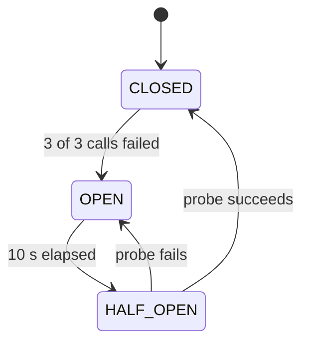
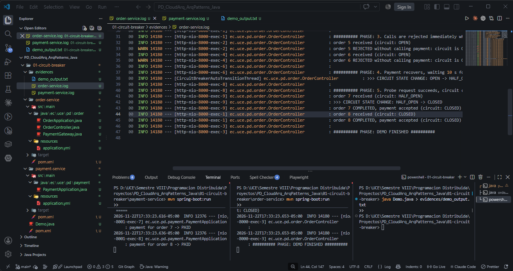

<div align="center">

**UNIVERSIDAD CENTRAL DEL ECUADOR**
**FACULTY OF ENGINEERING AND APPLIED SCIENCES**
**INFORMATION SYSTEMS**
**DISTRIBUTED PROGRAMMING**

### Circuit Breaker Pattern

**PROFESSOR:**
ING. JUAN PABLO GUEVARA

**NAME:**
CHILUISA ALEXIS

**ACADEMIC PERIOD:**
2026 – 2027

**DATE:**
23/11/2027

</div>

---

# 01 - Circuit Breaker (Java)

## What is it?

A resilience pattern that stops an application from repeatedly calling a service that is failing.
It prevents cascading failures, saves resources and gives the failing service time to recover.

## How does it work?

The breaker sits between the caller and the dependency and has three states:

| State       | Behavior                                                                                                 |
| ----------- | -------------------------------------------------------------------------------------------------------- |
| `CLOSED`    | Calls go through; failures are counted.                                                                  |
| `OPEN`      | After the failure threshold is reached, calls are rejected immediately without reaching the service.     |
| `HALF_OPEN` | After a recovery timeout, one probe call is allowed. Success closes the circuit; failure opens it again. |



## Where can it be used?

Microservices, e-commerce, payment platforms, authentication services and any application that consumes external APIs.
Example: a university system whose payment provider is down should not block the rest of the academic modules.

## Implementation in this project

Two Spring Boot microservices. The order service protects its calls to the payment service with **Resilience4j**.


| Path                                               | Content                                                                                                                                                                                  |
| -------------------------------------------------- | ---------------------------------------------------------------------------------------------------------------------------------------------------------------------------------------- |
| `payment-service/.../PaymentApplication.java`      | Simulated payments. `POST /admin/health` makes it fail or recover on demand. Logs to `evidences/payment-service.log`.                                                                    |
| `order-service/.../PaymentGateway.java`            | Payment call annotated with `@CircuitBreaker(name = "payment")`.                                                                                                                         |
| `order-service/.../OrderController.java`           | `POST /orders/{id}`, `GET /breaker`, `POST /demo/phase`; maps errors (`502` payment failure, `503` circuit open) and logs orders and state transitions to `evidences/order-service.log`. |
| `order-service/src/main/resources/application.yml` | Breaker settings: window of 3 calls, 100% failure threshold, 10 s in OPEN, 1 probe call in HALF_OPEN.                                                                                    |
| `Demo.java`                                        | Runs the full cycle `CLOSED -> OPEN -> HALF_OPEN -> CLOSED` and marks each phase in the order service log.                                                                               |

## How to run

Requirements: JDK 17+ and Maven. Start each service **from its own folder** so its log is written to `evidences/`.
Delete old `.log` files first: logs are appended on every start.

```bash
# terminal 1
cd 01-circuit-breaker/payment-service
mvn spring-boot:run

# terminal 2
cd 01-circuit-breaker/order-service
mvn spring-boot:run

# terminal 3 (saves the console output as evidence)
cd 01-circuit-breaker
java Demo.java > evidences/demo_output.txt
```

> Windows PowerShell writes `>` redirections as UTF-16. To get a plain UTF-8 file use
> `java Demo.java | Out-File -Encoding utf8 evidences/demo_output.txt`, or run the command from Git Bash or `cmd`.

Expected: orders 2-4 return `502` (the breaker reaches `OPEN` on the third), orders 5-6 return `503` immediately,
and after 10 s the next order closes the circuit and returns `200`.

## Evidences

Raw files are stored in the [evidences/](evidences/) folder. Three files describe the same run from three points of view:

| File                            | Point of view                                                                                                 | How to generate                               |
| ------------------------------- | ------------------------------------------------------------------------------------------------------------- | --------------------------------------------- |
| `evidences/demo_output.txt`     | The client: HTTP status of each order and the breaker state after it.                                         | `java Demo.java > evidences/demo_output.txt`  |
| `evidences/order-service.log`   | The order service: phases, each order received and its result, payment failures and every circuit transition. | Created automatically by the order service.   |
| `evidences/payment-service.log` | The payment service: when it goes DOWN/UP and which payments actually reached it.                             | Created automatically by the payment service. |

Key markers in the order service log:

- `########## PHASE: ... ##########`: where each phase of the demo starts.
- `order N received (circuit: X)`: circuit state when the order arrived, followed by `COMPLETED`, `payment call failed` or `REJECTED`.
- `>>> CIRCUIT STATE CHANGE: A -> B`: the exact moment of each transition.

### How the three files relate

| Order       | Demo output         | Order service log                            | Payment service log                      |
| ----------- | ------------------- | -------------------------------------------- | ---------------------------------------- |
| 1           | `200`, `CLOSED`     | `COMPLETED`                                  | `PAID`                                   |
| 2, 3        | `502`, `CLOSED`     | `payment call failed`                        | `FAILED (500)`                           |
| 4           | `502`, `OPEN`       | `payment call failed`, then `CLOSED -> OPEN` | `FAILED (500)`                           |
| 5, 6        | `503`, `OPEN`       | `REJECTED ... circuit is OPEN`               | **no entry** (never reached the service) |
| (10 s wait) | `breaker=HALF_OPEN` | `OPEN -> HALF_OPEN`                          | no entry                                 |
| 7           | `200`, `CLOSED`     | `HALF_OPEN -> CLOSED`, `COMPLETED`           | `PAID`                                   |
| 8           | `200`, `CLOSED`     | `COMPLETED`                                  | `PAID`                                   |

The missing entries for orders 5 and 6 in the payment log are the proof of the pattern:
while the circuit is open, the failing service receives no traffic.

Generated on 2026-11-22 in a single run. The full files are in [evidences/](evidences/);
the excerpts below keep only the relevant lines (Spring/Tomcat start-up noise, dates and logger names removed).

### Demo output (`demo_output.txt`)

```text
== 1. Normal traffic (circuit CLOSED)
order 1: HTTP 200 | breaker={"state":"CLOSED"}
== 2. Payment service fails: 3 failures open the circuit
--- payment service healthy=false
order 2: HTTP 502 | breaker={"state":"CLOSED"}
order 3: HTTP 502 | breaker={"state":"CLOSED"}
order 4: HTTP 502 | breaker={"state":"OPEN"}
== 3. Calls are rejected immediately while the circuit is OPEN
order 5: HTTP 503 | breaker={"state":"OPEN"}
order 6: HTTP 503 | breaker={"state":"OPEN"}
== 4. Payment recovers, waiting 10 s for HALF_OPEN
--- payment service healthy=true
breaker={"state":"HALF_OPEN"}
== 5. Probe request succeeds, circuit closes
order 7: HTTP 200 | breaker={"state":"CLOSED"}
order 8: HTTP 200 | breaker={"state":"CLOSED"}
== DEMO FINISHED
```

### Order service log (`order-service.log`)

```text
17:33:05.866 INFO  ===== ORDER SERVICE STARTED on port 8000 (circuit: CLOSED) =====
17:33:12.653 INFO  ########## PHASE: 1. Normal traffic (circuit CLOSED) ##########
17:33:12.693 INFO  order 1 received (circuit: CLOSED)
17:33:12.928 INFO  order 1 COMPLETED, payment accepted (circuit: CLOSED)
17:33:12.951 INFO  ########## PHASE: 2. Payment service fails: 3 failures open the circuit ##########
17:33:12.971 INFO  order 2 received (circuit: CLOSED)
17:33:12.984 WARN  payment call failed (InternalServerError)
17:33:12.985 ERROR order 2 FAILED: payment error (502): 500 : "{"detail":"payment gateway down"}"
17:33:13.000 INFO  order 3 received (circuit: CLOSED)
17:33:13.013 WARN  payment call failed (InternalServerError)
17:33:13.014 ERROR order 3 FAILED: payment error (502): 500 : "{"detail":"payment gateway down"}"
17:33:13.029 INFO  order 4 received (circuit: CLOSED)
17:33:13.035 WARN  payment call failed (InternalServerError)
17:33:13.038 INFO  >>> CIRCUIT STATE CHANGE: CLOSED -> OPEN
17:33:13.039 ERROR order 4 FAILED: payment error (502): 500 : "{"detail":"payment gateway down"}"
17:33:13.049 INFO  ########## PHASE: 3. Calls are rejected immediately while the circuit is OPEN ##########
17:33:13.053 INFO  order 5 received (circuit: OPEN)
17:33:13.054 WARN  order 5 REJECTED without calling payment: circuit is OPEN (503)
17:33:13.068 INFO  order 6 received (circuit: OPEN)
17:33:13.068 WARN  order 6 REJECTED without calling payment: circuit is OPEN (503)
17:33:13.080 INFO  ########## PHASE: 4. Payment recovers, waiting 10 s for HALF_OPEN ##########
17:33:23.046 INFO  >>> CIRCUIT STATE CHANGE: OPEN -> HALF_OPEN
17:33:23.610 INFO  ########## PHASE: 5. Probe request succeeds, circuit closes ##########
17:33:23.613 INFO  order 7 received (circuit: HALF_OPEN)
17:33:23.619 INFO  >>> CIRCUIT STATE CHANGE: HALF_OPEN -> CLOSED
17:33:23.620 INFO  order 7 COMPLETED, payment accepted (circuit: CLOSED)
17:33:23.632 INFO  order 8 received (circuit: CLOSED)
17:33:23.639 INFO  order 8 COMPLETED, payment accepted (circuit: CLOSED)
17:33:23.653 INFO  ########## PHASE: DEMO FINISHED ##########
```

### Payment service log (`payment-service.log`)

```text
17:33:02.817 INFO  ===== PAYMENT SERVICE STARTED on port 8001 (status: UP) =====
17:33:12.871 INFO  payment for order 1 -> PAID
17:33:12.963 INFO  ===== PAYMENT SERVICE SET TO DOWN (simulated failure) =====
17:33:12.978 WARN  payment for order 2 -> FAILED (500), service is DOWN
17:33:13.006 WARN  payment for order 3 -> FAILED (500), service is DOWN
17:33:13.033 WARN  payment for order 4 -> FAILED (500), service is DOWN
17:33:13.084 INFO  ===== PAYMENT SERVICE SET TO UP (recovered) =====
17:33:23.616 INFO  payment for order 7 -> PAID
17:33:23.636 INFO  payment for order 8 -> PAID
```

### screenshot



### What the evidence shows

- **Orders 2, 3 and 4** fail in the payment service (`FAILED (500)`). The third failure opens the circuit (`CLOSED -> OPEN`) right before order 4 answers `502`.
- **Orders 5 and 6** are rejected with `503` by the order service (`REJECTED without calling payment`) and **do not appear in the payment log**: the failing service received no traffic while the circuit was open.
- About **10 s** after opening (`..:13.038` to `..:23.046`) the circuit moves to `HALF_OPEN` by itself, without any request.
- **Order 7** is the probe: it reaches the payment service, succeeds and closes the circuit (`HALF_OPEN -> CLOSED`). Order 8 goes through normally.
