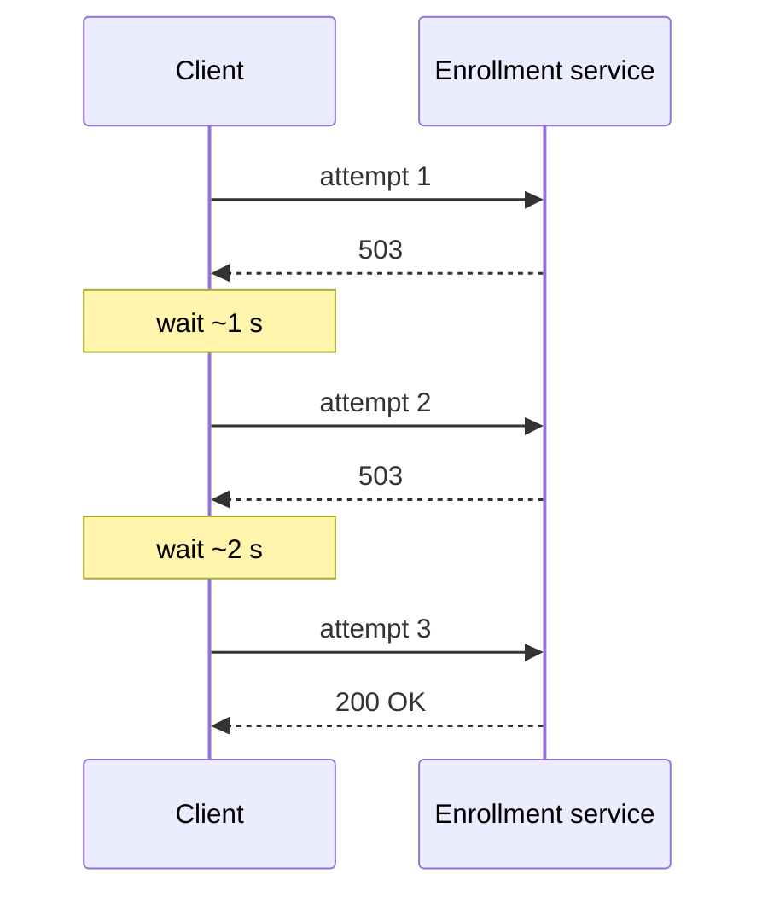
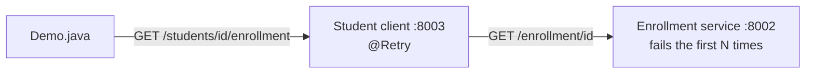
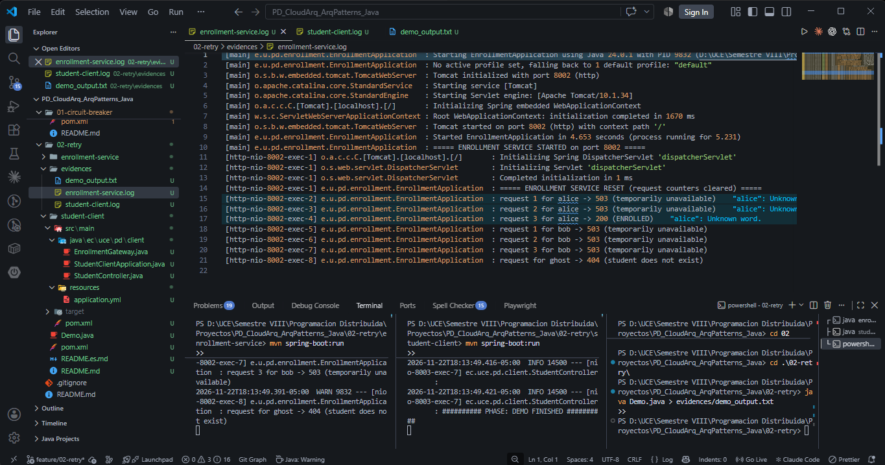

<div align="center">

**UNIVERSIDAD CENTRAL DEL ECUADOR**
**FACULTY OF ENGINEERING AND APPLIED SCIENCES**
**INFORMATION SYSTEMS**
**DISTRIBUTED PROGRAMMING**

### Retry Pattern

**PROFESSOR:**
ING. JUAN PABLO GUEVARA

**NAME:**
CHILUISA ALEXIS

**ACADEMIC PERIOD:**
2026 – 2027

**DATE:**
23/11/2027

</div>

---

# 02 - Retry (Java)

## What is it?

A resilience pattern that re-executes an operation that failed because of a probably **transient** problem
(a network blip, a temporary overload, an HTTP 503). It improves fault tolerance and lets the operation finish without user intervention once the problem disappears.

## How does it work?

The client detects a recoverable failure and repeats the request following a policy:

- **Exponential backoff:** the wait grows between attempts (1 s, 2 s, 4 s...), so a recovering service is not flooded.
- **Jitter:** a small random variation of the wait, so many clients do not retry at the same instant.
- **Limit:** a maximum number of attempts; after that the error is propagated.
- **Only transient errors:** a `503` is retried, a `404` or `400` is not, because repeating it changes nothing.
- **Only idempotent operations:** repeating them must not produce duplicated effects (a query yes, a payment no).



## Where can it be used?

Microservice calls, HTTP requests, database operations, external APIs and message processing.
Example: a university app queries an enrollment status, gets a temporary `503` and retries before showing an error.

## Implementation in this project

Two Spring Boot microservices. The student client protects its calls to the enrollment service with **Resilience4j** `@Retry`.



| Path                                                | Content                                                                                                                                                         |
| --------------------------------------------------- | --------------------------------------------------------------------------------------------------------------------------------------------------------------- |
| `enrollment-service/.../EnrollmentApplication.java` | Answers `503` to the first `failTimes` requests of each student and `200` afterwards; `ghost` always answers `404`. Logs to `evidences/enrollment-service.log`. |
| `student-client/.../EnrollmentGateway.java`         | The call to the enrollment service, annotated with `@Retry(name = "enrollment")`. Each invocation is one numbered attempt.                                      |
| `student-client/.../StudentController.java`         | `GET /students/{id}/enrollment`, `POST /demo/phase`; logs every retry with its wait and the final result to `evidences/student-client.log`.                     |
| `student-client/src/main/resources/application.yml` | Policy: 3 attempts, exponential backoff starting at 1 s (x2) with 20 % jitter, only `503` and connection errors are retried.                                    |
| `Demo.java`                                         | Runs the three scenarios and marks each one in the client log.                                                                                                  |

Scenarios of the demo:

1. **alice:** two `503` followed by success. Recovers on attempt 3.
2. **bob:** every attempt fails. Gives up after 3 attempts and answers `503`.
3. **ghost:** the student does not exist (`404`). It is **not retried**: only 1 attempt.

## How to run

Requirements: JDK 17+ and Maven. Start each service **from its own folder** so its log is written to `evidences/`.
Delete old `.log` files first: logs are appended on every start.

```bash
# terminal 1
cd 02-retry/enrollment-service
mvn spring-boot:run

# terminal 2
cd 02-retry/student-client
mvn spring-boot:run

# terminal 3 (saves the console output as evidence)
cd 02-retry
java Demo.java > evidences/demo_output.txt
```

> Windows PowerShell writes `>` redirections as UTF-16. To get a plain UTF-8 file use
> `java Demo.java | Out-File -Encoding utf8 evidences/demo_output.txt`, or run the command from Git Bash or `cmd`.

Expected: alice answers `200` after about 3 s (1 s + 2 s of waiting) with `attempts: 3`, bob answers `503` after about 3 s with 3 attempts,
and ghost answers `404` immediately with a single attempt.

## Evidences

Raw files are stored in the [evidences/](evidences/) folder. Three files describe the same run from three points of view:

| File                               | Point of view                                                                      | How to generate                                  |
| ---------------------------------- | ---------------------------------------------------------------------------------- | ------------------------------------------------ |
| `evidences/demo_output.txt`        | The caller: HTTP status, total time and number of attempts of each scenario.       | `java Demo.java > evidences/demo_output.txt`     |
| `evidences/student-client.log`     | The client: each attempt, the waits between them and the final result.             | Created automatically by the student client.     |
| `evidences/enrollment-service.log` | The enrollment service: every request it received and the `503`/`200` it answered. | Created automatically by the enrollment service. |

Key markers in the student client log:

- `########## PHASE: ... ##########`: where each scenario starts.
- `attempt N -> GET ...` and `attempt N <- HTTP xxx`: each attempt and its answer.
- `>>> RETRY #N: waiting X ms ...`: the pause before the next attempt (about 1000 ms, then about 2000 ms).
- `RESOLVED after N attempt(s)`, `FAILED: gave up after N attempts` or `NOT FOUND ... not retried`: the final result.

Generated on 2026-11-22 in a single run. The full files are in [evidences/](evidences/);
the excerpts below keep only the relevant lines (Spring/Tomcat start-up noise, dates, process ids and logger names removed).

### Demo output (`demo_output.txt`)

```text
== 1. Two transient failures, then success (recovers on attempt 3)
alice: HTTP 200 in 3904 ms | {"studentId":"alice","enrollment":{"status":"ENROLLED","studentId":"alice"},"attempts":3}
== 2. Every attempt fails (gives up after 3 attempts)
bob: HTTP 503 in 3173 ms | {"detail":"enrollment service unavailable after 3 attempts"}
== 3. Non-transient error: 404 is not retried
ghost: HTTP 404 in 35 ms | {"detail":"student not found"}
== DEMO FINISHED
```

### Student client log (`student-client.log`)

```text
18:13:05.934 INFO  ===== STUDENT CLIENT STARTED on port 8003 (max 3 attempts, exponential backoff) =====
18:13:42.243 INFO  ########## PHASE: 1. Two transient failures, then success (recovers on attempt 3) ##########
18:13:42.280 INFO  request for student alice received
18:13:42.299 INFO    attempt 1 -> GET /enrollment/alice
18:13:42.404 WARN    attempt 1 <- HTTP 503
18:13:42.416 WARN    >>> RETRY #1: waiting 1157 ms before the next attempt
18:13:43.575 INFO    attempt 2 -> GET /enrollment/alice
18:13:43.588 WARN    attempt 2 <- HTTP 503
18:13:43.601 WARN    >>> RETRY #2: waiting 2368 ms before the next attempt
18:13:45.981 INFO    attempt 3 -> GET /enrollment/alice
18:13:46.141 INFO    attempt 3 <- HTTP 200
18:13:46.143 INFO  student alice RESOLVED after 3 attempt(s)
18:13:46.189 INFO  ########## PHASE: 2. Every attempt fails (gives up after 3 attempts) ##########
18:13:46.194 INFO  request for student bob received
18:13:46.195 INFO    attempt 1 -> GET /enrollment/bob
18:13:46.201 WARN    attempt 1 <- HTTP 503
18:13:46.201 WARN    >>> RETRY #1: waiting 894 ms before the next attempt
18:13:47.098 INFO    attempt 2 -> GET /enrollment/bob
18:13:47.112 WARN    attempt 2 <- HTTP 503
18:13:47.113 WARN    >>> RETRY #2: waiting 2143 ms before the next attempt
18:13:49.258 INFO    attempt 3 -> GET /enrollment/bob
18:13:49.279 WARN    attempt 3 <- HTTP 503
18:13:49.302 ERROR student bob FAILED: gave up after 3 attempts (503)
18:13:49.373 INFO  ########## PHASE: 3. Non-transient error: 404 is not retried ##########
18:13:49.380 INFO  request for student ghost received
18:13:49.381 INFO    attempt 1 -> GET /enrollment/ghost
18:13:49.398 WARN    attempt 1 <- HTTP 404
18:13:49.400 WARN  student ghost NOT FOUND (404): not retried, attempts: 1
18:13:49.421 INFO  ########## PHASE: DEMO FINISHED ##########
```

### Enrollment service log (`enrollment-service.log`)

```text
18:12:49.423 INFO  ===== ENROLLMENT SERVICE STARTED on port 8002 =====
18:13:41.982 INFO  ===== ENROLLMENT SERVICE RESET (request counters cleared) =====
18:13:42.388 WARN  request 1 for alice -> 503 (temporarily unavailable)
18:13:43.582 WARN  request 2 for alice -> 503 (temporarily unavailable)
18:13:45.991 INFO  request 3 for alice -> 200 (ENROLLED)
18:13:46.198 WARN  request 1 for bob -> 503 (temporarily unavailable)
18:13:47.106 WARN  request 2 for bob -> 503 (temporarily unavailable)
18:13:49.270 WARN  request 3 for bob -> 503 (temporarily unavailable)
18:13:49.391 WARN  request for ghost -> 404 (student does not exist)
```

### What the evidence shows

| Scenario | Attempts | Waits between attempts | Total time | Result |
|----------|----------|------------------------|------------|--------|
| alice | 3 | 1157 ms, 2368 ms | 3904 ms | `200`, recovered on attempt 3 |
| bob | 3 | 894 ms, 2143 ms | 3173 ms | `503`, gave up after 3 attempts |
| ghost | 1 | none | 35 ms | `404`, **not retried** |

- **Exponential backoff:** the second wait is about twice the first (1157 -> 2368 ms and 894 -> 2143 ms).
- **Jitter:** the waits are not exactly 1000 and 2000 ms; they vary within +/- 20 % and differ between alice and bob.
- **Limit:** bob stops at attempt 3 and the client answers `503` (`FAILED: gave up after 3 attempts`). Neither service goes down.
- **Only transient errors:** ghost receives a `404` and is not retried, so it takes a single attempt.
- **Both sides agree:** the enrollment service log shows the same sequence (alice `503, 503, 200`; bob `503, 503, 503`; ghost `404`), and the pauses between its request timestamps match the `RETRY` waits in the client log.

### Screenshots

Enrollment service log open in the editor, with the three terminals running: the enrollment service, the student client and `Demo.java`.


