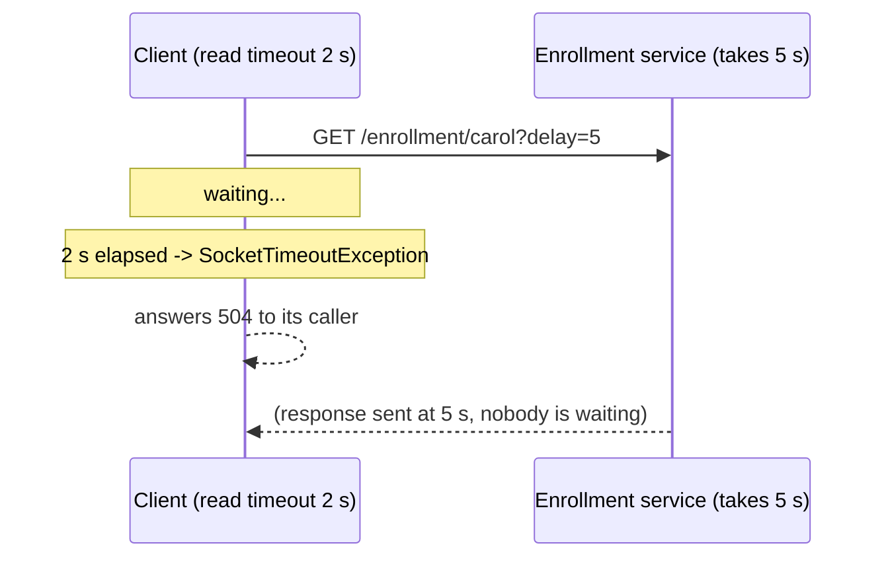
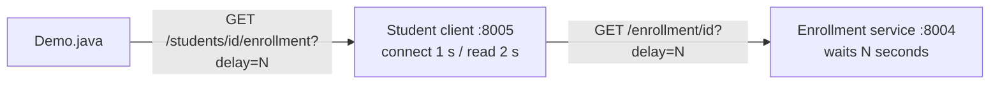
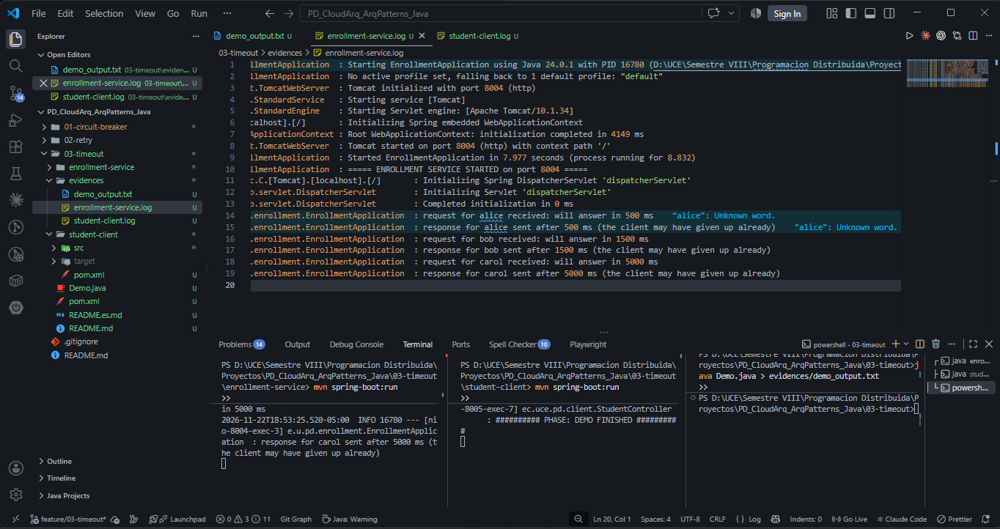

<div align="center">

**UNIVERSIDAD CENTRAL DEL ECUADOR**
**FACULTY OF ENGINEERING AND APPLIED SCIENCES**
**INFORMATION SYSTEMS**
**DISTRIBUTED PROGRAMMING**

## Timeout Pattern

**PROFESSOR:**
ING. JUAN PABLO GUEVARA

**NAME:**
CHILUISA ALEXIS

**ACADEMIC PERIOD:**
2026 – 2027

**DATE:**
23/11/2027

</div>

---

# 03 - Timeout (Java)

## What is it?

A control mechanism that sets the maximum time an application waits for a response or for an operation to finish.
It avoids indefinite waits, frees resources (threads, connections) and keeps response times predictable when a dependency is slow or stops answering.

## How does it work?

The client configures a time limit. If the operation does not finish within it, a timeout exception is raised and an error policy is applied
(fallback, retry, error message to the user).

Two limits must be distinguished:

- **Connection timeout:** max time to establish the connection.
- **Read (response) timeout:** max time to wait for the response once connected.

AWS recommends setting both explicitly and tuning them to each service.



## Where can it be used?

HTTP calls, database queries, microservice communication and any operation that depends on external systems.
Example: an academic module asks the enrollment service, which takes too long; the timeout lets it inform the user instead of hanging.

## Implementation in this project

Two Spring Boot microservices. The student client sets explicit timeouts on its HTTP client (connect 1 s, read 2 s).



| Path                                                | Content                                                                                                                                                           |
| --------------------------------------------------- | ----------------------------------------------------------------------------------------------------------------------------------------------------------------- |
| `enrollment-service/.../EnrollmentApplication.java` | `GET /enrollment/{id}?delay=N` waits N seconds before answering. Logs to `evidences/enrollment-service.log`.                                                      |
| `student-client/.../StudentClientApplication.java`  | Builds the HTTP client with the connect and read timeouts.                                                                                                        |
| `student-client/.../StudentController.java`         | `GET /students/{id}/enrollment`, `POST /demo/phase`; measures each call, answers `504` on a read timeout and logs the duration to `evidences/student-client.log`. |
| `student-client/src/main/resources/application.yml` | `connect-timeout-ms: 1000` and `read-timeout-ms: 2000`.                                                                                                           |
| `Demo.java`                                         | Queries the enrollment of three students with delays of 0.5 s, 1.5 s and 5 s and marks each scenario in the client log.                                           |

Scenarios of the demo:

1. **alice, 0.5 s:** well inside the limit. `200`.
2. **bob, 1.5 s:** slower, but still inside the limit. `200`.
3. **carol, 5 s:** exceeds the limit. The client stops waiting after about 2 s and answers `504` instead of blocking for 5 s.

## How to run

Requirements: JDK 17+ and Maven. Start each service **from its own folder** so its log is written to `evidences/`.
Delete old `.log` files first: logs are appended on every start.

```bash
# terminal 1
cd 03-timeout/enrollment-service
mvn spring-boot:run

# terminal 2
cd 03-timeout/student-client
mvn spring-boot:run

# terminal 3 (saves the console output as evidence)
cd 03-timeout
java Demo.java > evidences/demo_output.txt
```

Wait about 5 seconds after the demo finishes before stopping the services: the enrollment service still logs the response of the 5 s request,
which shows that it kept working after the client had already given up.

Expected: the 0.5 s and 1.5 s requests answer `200` in about those times, and the 5 s request answers `504` after about 2 s.

## Evidences

Raw files are stored in the [evidences/](evidences/) folder. Three files describe the same run from three points of view:

| File                               | Point of view                                                | How to generate                                  |
| ---------------------------------- | ------------------------------------------------------------ | ------------------------------------------------ |
| `evidences/demo_output.txt`        | The caller: HTTP status and total time of each request.      | `java Demo.java > evidences/demo_output.txt`     |
| `evidences/student-client.log`     | The client: each request, its duration and the timeout.      | Created automatically by the student client.     |
| `evidences/enrollment-service.log` | The service: when each request arrived and when it answered. | Created automatically by the enrollment service. |

Key markers in the client log:

- `########## PHASE: ... ##########`: where each scenario starts.
- `request for student X sent: service will take N ms, read timeout is Y ms`: what is about to happen.
- `response received in X ms -> OK`: the request finished within the limit.
- `TIMEOUT after X ms (limit Y ms)`: the limit was exceeded and the client stopped waiting.

Generated on 2026-11-22 in a single run. The full files are in [evidences/](evidences/);
the excerpts below keep only the relevant lines (Spring/Tomcat start-up noise, dates, process ids and logger names removed).

### Demo output (`demo_output.txt`)

```text
== 1. Fast response (0.5 s): well inside the 2 s limit
alice (delay=0.5s): HTTP 200 in 875 ms | {"studentId":"alice","delayMs":500,"status":"ENROLLED"}
== 2. Slower response (1.5 s): still inside the 2 s limit
bob (delay=1.5s): HTTP 200 in 1537 ms | {"studentId":"bob","delayMs":1500,"status":"ENROLLED"}
== 3. Very slow response (5 s): the 2 s limit is exceeded
carol (delay=5.0s): HTTP 504 in 2085 ms | {"detail":"enrollment service did not answer within 2000 ms"}
== DEMO FINISHED
```

### Student client log (`student-client.log`)

```text
18:51:58.185 INFO  ===== STUDENT CLIENT STARTED on port 8005 (connect timeout 1000 ms, read timeout 2000 ms) =====
18:53:17.947 INFO  ########## PHASE: 1. Fast response (0.5 s): well inside the 2 s limit ##########
18:53:18.038 INFO  request for student alice sent: service will take 500 ms, read timeout is 2000 ms
18:53:18.860 INFO  student alice response received in 820 ms -> OK
18:53:18.909 INFO  ########## PHASE: 2. Slower response (1.5 s): still inside the 2 s limit ##########
18:53:18.921 INFO  request for student bob sent: service will take 1500 ms, read timeout is 2000 ms
18:53:20.441 INFO  student bob response received in 1516 ms -> OK
18:53:20.462 INFO  ########## PHASE: 3. Very slow response (5 s): the 2 s limit is exceeded ##########
18:53:20.489 INFO  request for student carol sent: service will take 5000 ms, read timeout is 2000 ms
18:53:22.504 ERROR student carol TIMEOUT after 2008 ms (limit 2000 ms): Read timed out
18:53:22.572 INFO  ########## PHASE: DEMO FINISHED ##########
```

### Enrollment service log (`enrollment-service.log`)

```text
18:51:54.305 INFO  ===== ENROLLMENT SERVICE STARTED on port 8004 =====
18:53:18.200 INFO  request for alice received: will answer in 500 ms
18:53:18.703 INFO  response for alice sent after 500 ms (the client may have given up already)
18:53:18.927 INFO  request for bob received: will answer in 1500 ms
18:53:20.435 INFO  response for bob sent after 1500 ms (the client may have given up already)
18:53:20.506 INFO  request for carol received: will answer in 5000 ms
18:53:25.520 INFO  response for carol sent after 5000 ms (the client may have given up already)
```

### What the evidence shows

| Student | Service delay | Read timeout | Time measured by the client | Result                                |
| ------- | ------------- | ------------ | --------------------------- | ------------------------------------- |
| alice   | 500 ms        | 2000 ms      | 820 ms                      | `200`, inside the limit               |
| bob     | 1500 ms       | 2000 ms      | 1516 ms                     | `200`, inside the limit               |
| carol   | 5000 ms       | 2000 ms      | 2008 ms                     | `504`, **timeout** (`Read timed out`) |

- **The limit is enforced:** carol would have waited 5 s, but the client stops after 2008 ms (the configured 2000 ms plus a few milliseconds of overhead) and answers `504`.
- **Successful calls are not affected:** alice and bob finish in about their service delay. The first request (alice) takes a bit longer in total (875 ms from the demo) because of the warm-up of the first connection.
- **The service keeps working after the client gives up:** the service received carol's request at `18:53:20.506`, the client gave up at `18:53:22.504`, and the service still sent its response at `18:53:25.520`, about 3 s later, when nobody was waiting for it. See the next section.

### Screenshots

Enrollment service log open in the editor, with the three terminals running: the enrollment service (its last line is the late response for carol), the student client and `Demo.java`.



## What happens to a late response?

When the service answers after the client's limit, **the response is discarded**: the client has already closed the connection and answered `504` to its caller, so nobody reads it.
The evidence above shows it with carol: the client gave up at `18:53:22.504` and the service logged `response for carol sent after 5000 ms` at `18:53:25.520`.

This has two consequences:

- **Wasted work:** the service used a thread and processing time for the full 5 s to produce a response nobody used. Timeout protects the client, but it does not cancel the work on the server.
  To avoid it, the deadline would have to be propagated (for example with a deadline header) or a timeout would also have to be set on the server.
- **Ambiguous result:** the client only knows that it did not get an answer in time, not whether the operation was executed or not.
  For an enrollment query it does not matter, but for a payment or a charge the service might have processed it anyway.
  That is why Timeout is combined with idempotent operations, which is the same condition that Retry requires.

## How the three resilience patterns fit together

| Pattern         | Problem it solves   | Mechanism                                 |
| --------------- | ------------------- | ----------------------------------------- |
| Circuit Breaker | Persistent failures | Temporarily blocks calls                  |
| Retry           | Transient failures  | Repeats the operation in a controlled way |
| Timeout         | Excessive waiting   | Limits the wait time                      |

They are complementary: Timeout detects slow operations, Retry recovers from temporary faults and Circuit Breaker stops sending requests to a dependency that keeps failing.
Without a timeout, a slow dependency would never produce an error, so neither Retry nor Circuit Breaker would have anything to react to.
