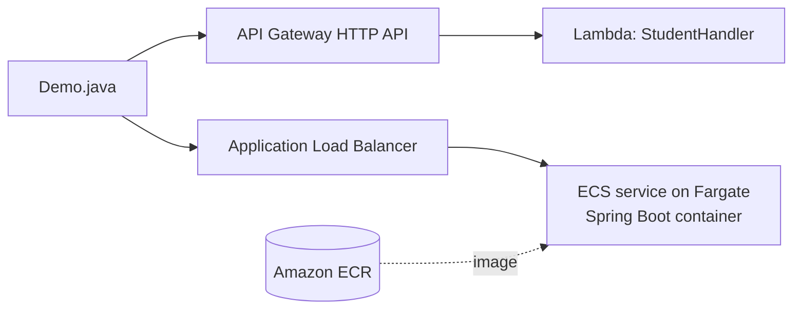

<div align="center">

**UNIVERSIDAD CENTRAL DEL ECUADOR**
**FACULTY OF ENGINEERING AND APPLIED SCIENCES**
**INFORMATION SYSTEMS**
**DISTRIBUTED PROGRAMMING**

## Serverless Computing and Docker Containers on AWS

**PROFESSOR:**
ING. JUAN PABLO GUEVARA

**NAME:**
CHILUISA ALEXIS

**ACADEMIC PERIOD:**
2026 – 2027

**DATE:**
23/11/2027

</div>

---

# 04 - Serverless (Lambda) and Docker containers (ECS + Fargate) (Java)

## What is it?

- **Serverless computing:** the provider manages the infrastructure; developers focus on code and business logic.
- **Docker:** packages an application with its dependencies into a portable, reproducible image.

On AWS:

- **AWS Lambda** runs functions in response to events without managing servers.
- **Amazon ECS** orchestrates containerized applications.
- **AWS Fargate** runs ECS containers without managing EC2 instances.

They are not opposites: a Lambda function can be shipped as a container image, and ECS with Fargate is also a managed infrastructure model.

## How does it work?

- **Lambda:** you deploy a function and configure the events that trigger it. AWS provisions and scales the runtime on demand.
- **ECS:** you define the container image, CPU/memory, networking and tasks. ECS runs them on EC2 or Fargate.

|                    | AWS Lambda                | Amazon ECS + Fargate                                             |
| ------------------ | ------------------------- | ---------------------------------------------------------------- |
| Unit of deployment | Function (jar)            | Container image                                                  |
| Runs               | On demand, per request    | Continuously (service)                                           |
| Max duration       | 15 minutes                | Unlimited                                                        |
| Scaling            | Automatic, down to zero   | Configured (number of tasks / autoscaling)                       |
| Billing            | Per request and duration  | Per vCPU and memory while tasks run                              |
| First request      | Cold start (slower)       | Already running                                                  |
| Best for           | Event-driven, short tasks | Persistent APIs, long processes, more control of the environment |

## Where can it be used?

- **Lambda:** file processing, automation, integrations, short-lived APIs.
- **ECS:** persistent APIs, microservices, long-running processes.
- University example: Lambda processes a document uploaded to S3, while ECS hosts the enrollment microservice.

## Implementation in this project

The same operation, `GET /students/{id}`, is deployed twice in AWS and then compared:



| Path                                             | Content                                                                                                                                                        |
| ------------------------------------------------ | -------------------------------------------------------------------------------------------------------------------------------------------------------------- |
| `lambda/src/main/java/.../StudentHandler.java`   | Lambda handler (API Gateway payload 2.0). Reports whether the call was a **cold start**. `lambda/pom.xml` builds one self-contained jar with the Shade plugin. |
| `ecs/src/main/java/.../StudentsApplication.java` | The same endpoint as a Spring Boot app, plus `/health` for the load balancer.                                                                                  |
| `ecs/Dockerfile`                                 | Multi-stage build: Maven builds the jar inside Docker, then a small JRE image runs it.                                                                         |
| `terraform/main.tf`                              | Provider, variables, outputs, and the reuse of the existing `LabRole`.                                                                                         |
| `terraform/lambda.tf`                            | Lambda function + API Gateway HTTP API + permission.                                                                                                           |
| `terraform/ecs.tf`                               | ECR repository (always) and, once an image is set, the ECS cluster, Fargate service, ALB, target group and security groups.                                    |
| `Demo.java`                                      | Sends 10 requests to each URL and compares first-request and average times.                                                                                    |

### AWS Academy Learner Lab notes

- **No IAM roles can be created:** Lambda and ECS use the pre-created `LabRole` (`data "aws_iam_role" "lab"`).
- **Regions:** only `us-east-1` and `us-west-2` are available; the default is `us-east-1`.
- **Temporary credentials:** they expire when the lab session ends. After restarting the lab, copy the new credentials (see below).
- **Cost:** the ALB and the Fargate task are billed while they exist. Run `terraform destroy` when you finish.

## Prerequisites (Windows)

### 1. Terraform

```powershell
winget install --id Hashicorp.Terraform -e
```

Close and reopen the terminal, then check it:

```powershell
terraform version
```

If `winget` is not available, download the Windows amd64 zip from <https://developer.hashicorp.com/terraform/install>, extract `terraform.exe` and add its folder to the `PATH`.

### 2. AWS CLI

```powershell
winget install --id Amazon.AWSCLI -e
```

Reopen the terminal and check it with `aws --version`.

### 3. Learner Lab credentials

1. In AWS Academy open the Learner Lab and press **Start Lab** until the AWS indicator is green.
2. Open **AWS Details** and press **Show** next to _AWS CLI_.
3. Copy the three values into the file `%USERPROFILE%\.aws\credentials` (create the folder and file if needed):

```ini
[default]
aws_access_key_id=...
aws_secret_access_key=...
aws_session_token=...
```

4. Set the region in `%USERPROFILE%\.aws\config`:

```ini
[default]
region=us-east-1
```

5. Verify the connection:

```powershell
aws sts get-caller-identity
```

It must print an account and an ARN containing `voclabs`. Never commit or share these credentials.

### 4. Docker and Maven

Docker Desktop must be running (`docker version`) and Maven must be installed (`mvn -version`).

## How to deploy

Run the commands from `04-serverless-docker/`. Deployment is done in two `terraform apply` steps because the ECS service needs the image to exist in ECR first.

```powershell
# 1. Build the Lambda jar
cd lambda
mvn package

# 2. First apply: Lambda + API Gateway + ECR repository
cd ../terraform
terraform init
terraform apply
terraform output
```

Take the registry from `ecr_repository_url` (the part before the first `/`) and push the image:

```powershell
# 3. Build and push the container image
cd ../ecs
docker build -t students-api .
aws ecr get-login-password --region us-east-1 | docker login --username AWS --password-stdin <registry>
docker tag students-api:latest <ecr_repository_url>:latest
docker push <ecr_repository_url>:latest

# 4. Second apply: ECS cluster, Fargate service and load balancer
cd ../terraform
terraform apply -var="container_image=<ecr_repository_url>:latest"
terraform output
```

The ALB needs 1 to 3 minutes to mark the task as healthy; until then it answers `503`.

```powershell
# 5. Compare both versions
cd ..
java Demo.java <lambda_api_url> <ecs_alb_url> > evidences/demo_output.txt
```

> Windows PowerShell writes `>` redirections as UTF-16. To get a plain UTF-8 file use
> `java Demo.java <lambda_api_url> <ecs_alb_url> | Out-File -Encoding utf8 evidences/demo_output.txt`, or run the command from Git Bash or `cmd`.

```powershell
# 6. Destroy everything to stop the charges
cd terraform
terraform destroy
```

What to expect: the Lambda **first request** is clearly slower (Java cold start, usually 1 to 3 s) and shows `"coldStart":true`; the next ones are fast.
The ECS version has no cold start, so its first request is similar to the rest.

## Evidences

Raw files are stored in the [evidences/](evidences/) folder. The deployment was done on 2026-11-22 in an AWS Academy Learner Lab, region `us-east-1`.

| File                              | Content                                                                                 |
| --------------------------------- | --------------------------------------------------------------------------------------- |
| `evidences/demo_output.txt`       | Output of `java Demo.java <lambda_api_url> <ecs_alb_url>`: 10 requests to each version. |
| `evidences/terraform_outputs.txt` | `terraform output`: Lambda API URL, ECR repository and ALB URL.                         |
| `evidences/cloudwatch_lambda.txt` | Lambda log copied from CloudWatch Logs (`/aws/lambda/students-api`).                    |
| `evidences/cloudwatch_ecs.txt`    | ECS container log copied from CloudWatch Logs (`/ecs/students-api`).                    |
| `evidences/*.png`                 | Screenshots of the deployment (listed below).                                           |

### Demo output (`demo_output.txt`)

```text
== AWS Lambda (API Gateway) | https://31pk563952.execute-api.us-east-1.amazonaws.com
request 1: HTTP 200 in 1585 ms | {"id":"1","name":"Ana Torres","runtime":"lambda","coldStart":true}
request 2: HTTP 200 in 146 ms | {"id":"1","name":"Ana Torres","runtime":"lambda","coldStart":false}
request 3: HTTP 200 in 152 ms | {"id":"1","name":"Ana Torres","runtime":"lambda","coldStart":false}
request 4: HTTP 200 in 133 ms | {"id":"1","name":"Ana Torres","runtime":"lambda","coldStart":false}
request 5: HTTP 200 in 148 ms | {"id":"1","name":"Ana Torres","runtime":"lambda","coldStart":false}
request 6: HTTP 200 in 136 ms | {"id":"1","name":"Ana Torres","runtime":"lambda","coldStart":false}
request 7: HTTP 200 in 130 ms | {"id":"1","name":"Ana Torres","runtime":"lambda","coldStart":false}
request 8: HTTP 200 in 131 ms | {"id":"1","name":"Ana Torres","runtime":"lambda","coldStart":false}
request 9: HTTP 200 in 132 ms | {"id":"1","name":"Ana Torres","runtime":"lambda","coldStart":false}
request 10: HTTP 200 in 138 ms | {"id":"1","name":"Ana Torres","runtime":"lambda","coldStart":false}
student 99: HTTP 404 | {"detail":"student not found"}
summary: first request 1585 ms | average of the next 9 requests 138 ms
== Amazon ECS on Fargate (ALB) | http://students-alb-1547682344.us-east-1.elb.amazonaws.com
request 1: HTTP 200 in 356 ms | {"id":"1","runtime":"ecs-fargate","name":"Ana Torres"}
request 2: HTTP 200 in 111 ms | {"id":"1","runtime":"ecs-fargate","name":"Ana Torres"}
request 3: HTTP 200 in 114 ms | {"id":"1","runtime":"ecs-fargate","name":"Ana Torres"}
request 4: HTTP 200 in 110 ms | {"id":"1","runtime":"ecs-fargate","name":"Ana Torres"}
request 5: HTTP 200 in 134 ms | {"id":"1","runtime":"ecs-fargate","name":"Ana Torres"}
request 6: HTTP 200 in 123 ms | {"id":"1","runtime":"ecs-fargate","name":"Ana Torres"}
request 7: HTTP 200 in 107 ms | {"id":"1","runtime":"ecs-fargate","name":"Ana Torres"}
request 8: HTTP 200 in 107 ms | {"id":"1","runtime":"ecs-fargate","name":"Ana Torres"}
request 9: HTTP 200 in 116 ms | {"id":"1","runtime":"ecs-fargate","name":"Ana Torres"}
request 10: HTTP 200 in 109 ms | {"id":"1","runtime":"ecs-fargate","name":"Ana Torres"}
student 99: HTTP 404 | {"detail":"student not found"}
summary: first request 356 ms | average of the next 9 requests 115 ms
== DEMO FINISHED
```

### Terraform outputs (`terraform_outputs.txt`)

```text
ecr_repository_url = "992382781245.dkr.ecr.us-east-1.amazonaws.com/students-api"
ecs_alb_url = "http://students-alb-1547682344.us-east-1.elb.amazonaws.com"
lambda_api_url = "https://31pk563952.execute-api.us-east-1.amazonaws.com"
```

### Lambda log (`cloudwatch_lambda.txt`)

Excerpt of the run of the demo. Times are UTC (the demo ran at 20:14 local time). The first request creates a new execution environment (`INIT_START`) and the handler reports `cold start: true`; the following ones reuse it.

```text
01:14:50.686 INIT_START (new execution environment created)
01:14:51.196 request for student 1 | cold start: true | 200
01:14:51.296 REPORT Duration: 171.24 ms Billed Duration: 606 ms Memory Size: 512 MB Max Memory Used: 94 MB Init Duration: 434.60 ms
01:14:51.459 request for student 1 | cold start: false | 200
01:14:51.462 REPORT Duration: 2.81 ms Billed Duration: 3 ms Memory Size: 512 MB Max Memory Used: 94 MB
...
01:14:52.702 request for student 99 | cold start: false | 404
```

### ECS log (`cloudwatch_ecs.txt`)

```text
01:10:04.518 INFO  Started StudentsApplication in 16.496 seconds (process running for 19.476)
01:10:04.589 INFO  ===== STUDENTS API (container) STARTED on port 8080 =====
01:13:34.611 INFO  request for student 1 -> 200
01:14:53.058 INFO  request for student 1 -> 200
01:14:53.192 INFO  request for student 1 -> 200
01:14:54.265 INFO  request for student 99 -> 404
```

### Screenshots

**1. `mvn package` ends with `BUILD SUCCESS` and the jar is created; then `terraform init` installs the AWS provider.**


**2. First test of the Lambda API: the PowerShell `curl` alias warning, and then `curl.exe` returning students 1 and 2 as JSON.**


**3. AWS console: the `students-api` Lambda function with API Gateway as its trigger.**


**4. AWS console: the `students-http-api` API with the route `GET /students/{id}`.**


**5. Container image pushed to Amazon ECR (`docker push`) and start of the second `terraform apply` that creates the ECS resources.**


**6. AWS console: cluster `students-cluster` with the active `students-service` (Fargate) and 1/1 tasks running.**


**7. AWS console: target group `students-tg` with 1 registered target in _Healthy_ state (port 8080), so the load balancer routes traffic to the task.**


### Comparison

Values measured by `Demo.java` (10 requests to `GET /students/1` per version, from the developer's computer):

|                                   | AWS Lambda (API Gateway)                                   | Amazon ECS + Fargate (ALB)                                                                               |
| --------------------------------- | ---------------------------------------------------------- | -------------------------------------------------------------------------------------------------------- |
| First request                     | **1585 ms** (`"coldStart":true`)                           | 356 ms                                                                                                   |
| Average of the next 9 requests    | 138 ms                                                     | 115 ms                                                                                                   |
| Unknown student (`/students/99`)  | `404`                                                      | `404`                                                                                                    |
| Work done by the code per request | about 2 ms (see the Lambda log)                            | not measured                                                                                             |
| Startup of the code               | cold start on the first call after creating an environment | the container started once, at deployment: Spring Boot reported 16.5 s                                   |
| Deployment steps                  | build one jar, `terraform apply`                           | build image, push to ECR, second `terraform apply`, wait for the ALB health check                        |
| Resources created                 | function, API, route, permission                           | repository, cluster, task definition, service, ALB, listener, target group, 2 security groups, log group |
| Billing model                     | per request and duration                                   | per vCPU and memory (and ALB hour) while it exists                                                       |

What the evidence shows:

- **Cold start:** the first Lambda request took about 1.4 s more than the following ones, and the log confirms the cause (`INIT_START` and `cold start: true`). On the AWS side the log accounts for about 0.6 s of it (`Init Duration: 434.60 ms` plus `Duration: 171.24 ms`); the rest includes opening the first connection and the platform preparing the environment, which the function log does not show. The ECS version has no cold start.
- **Warm requests:** both versions answer in about 110 to 140 ms from the developer's computer. That time is dominated by the network and the API Gateway or ALB hop, not by the code, which runs in about 2 ms.
- **First ECS request:** it is also slower (356 ms) than the rest, most likely because it opens a new connection to the load balancer; the application was already running.
- **Trade-off:** Lambda needs less infrastructure and no idle cost, but pays a cold start; ECS answers consistently but must be provisioned, runs (and bills) continuously and takes more steps to deploy.

The sample is small (10 requests from one location), so the figures illustrate the behavior but are not a benchmark.

> Once the evidences are collected, destroy the AWS resources with `terraform destroy` to stop the charges.
