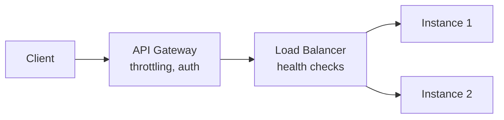
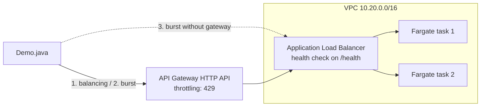

<div align="center">

**UNIVERSIDAD CENTRAL DEL ECUADOR**
**FACULTY OF ENGINEERING AND APPLIED SCIENCES**
**INFORMATION SYSTEMS**
**DISTRIBUTED PROGRAMMING**

## API Gateway, Load Balancer and Reverse Proxy

**PROFESSOR:**
ING. JUAN PABLO GUEVARA

**NAME:**
CHILUISA ALEXIS

**ACADEMIC PERIOD:**
2026 – 2027

**DATE:**
23/11/2027

</div>

---

# 05 - API Gateway, Load Balancer and Reverse Proxy (Java)

## What are they?

Three components that manage the communication between clients and services. Their responsibilities are different:

| Component         | Responsibility                                                                                                                                        |
| ----------------- | ----------------------------------------------------------------------------------------------------------------------------------------------------- |
| **API Gateway**   | Single entry point of an API: authentication, authorization, throttling (request rate limits), routing and API management.                            |
| **Load Balancer** | Distributes the traffic among several instances to improve availability, scalability and resource usage, and stops sending traffic to unhealthy ones. |
| **Reverse Proxy** | Receives the client requests and forwards them to internal servers, hiding their location. It can apply routing rules, TLS termination or caching.    |

## How do they work?

They can be combined, but using all of them is not mandatory:



On AWS the responsibilities overlap: an Application Load Balancer is at the same time a load balancer and a reverse proxy
(it receives the requests and forwards them to private targets, with path and host based routing), so adding Nginx is not always necessary.
The API Gateway adds what the ALB does not provide by itself, such as throttling and authorizers.

## Where can they be used?

Web applications, microservice platforms, enterprise systems and hybrid architectures.
University example: API Gateway controls the access to the academic services while an ALB spreads the requests among several instances of the enrollment microservice.

## Implementation in this project (AWS)

The same small API runs in **two Fargate tasks** behind an **Application Load Balancer**, and an **API Gateway** is placed in front of the ALB.
Everything lives in a **VPC created for this project**.



| Component                 | Role in this project                                                                                              |
| ------------------------- | ----------------------------------------------------------------------------------------------------------------- |
| API Gateway               | Entry point. Applies the rate limit (2 requests/s, burst 2) and answers `429` above it, without reaching the ALB. |
| Application Load Balancer | Load balancer and reverse proxy: spreads the requests between the two tasks and checks their health.              |
| ECS Fargate (2 tasks)     | The instances. Each one answers `GET /whoami` with its own hostname, so the answering instance can be identified. |

| Path                   | Content                                                                                                                  |
| ---------------------- | ------------------------------------------------------------------------------------------------------------------------ |
| `api/`                 | Spring Boot API (`/whoami`, `/health`) and its multi-stage `Dockerfile`.                                                 |
| `terraform/main.tf`    | Provider, variables (including the throttling limits), `LabRole` and outputs.                                            |
| `terraform/network.tf` | The VPC: Internet Gateway, two public subnets in different availability zones and the route table.                       |
| `terraform/ecs.tf`     | ECR repository (always) and, once an image is set: cluster, service with 2 tasks, ALB, target group and security groups. |
| `terraform/gateway.tf` | API Gateway HTTP API with a proxy integration to the ALB and the throttling settings.                                    |
| `Demo.java`            | Runs the three tests described below.                                                                                    |

Network design:

- The ALB accepts traffic from the Internet on port 80. The tasks accept traffic **only from the ALB security group** on port 8080, even though they are in public subnets with a public IP (needed to pull the image from ECR without a NAT gateway).
- The API Gateway reaches the ALB through its public URL. In a production design the ALB would be internal, in private subnets, and the gateway would reach it through a VPC Link, so that the gateway would be the only way in.
  Here the ALB is kept public on purpose, to be able to compare the behavior with and without the gateway.

What the demo does:

1. **Load balancing:** 12 sequential requests through the gateway. They are spread between the two tasks.
2. **Throttling:** a burst of 100 simultaneous requests through the gateway. A part is rejected with `429`.
3. **No gateway:** the same burst straight to the ALB. All of them answer `200`: the load balancer distributes the traffic but does not limit the rate.

The gateway throttling is approximate (token bucket), so the exact number of `429` varies between runs.

### AWS Academy Learner Lab notes

- **No IAM roles can be created:** ECS uses the pre-created `LabRole`.
- **Regions:** only `us-east-1` and `us-west-2` are available; the default is `us-east-1`.
- **Temporary credentials:** they expire when the lab session ends. After restarting the lab, copy the new credentials to `%USERPROFILE%\.aws\credentials`.
- **Cost:** the ALB and the two Fargate tasks are billed while they exist. Run `terraform destroy` when you finish.

## How to deploy

Prerequisites: Terraform, AWS CLI with the Learner Lab credentials (`aws sts get-caller-identity` must work), Docker Desktop running and Maven.
Run the commands from `05-gateway-loadbalancer-proxy/`. Deployment is done in two `terraform apply` steps because the ECS service needs the image to exist in ECR first.

```powershell
# 1. First apply: ECR repository and VPC
cd terraform
terraform init
terraform apply
$ecr = terraform output -raw ecr_repository_url
$registry = $ecr.Split('/')[0]

# 2. Build and push the container image
cd ../api
docker build -t whoami-api .
$pw = aws ecr get-login-password --region us-east-1
docker login --username AWS --password $pw $registry
docker tag whoami-api:latest "${ecr}:latest"
docker push "${ecr}:latest"

# 3. Second apply: ECS (2 tasks), ALB and API Gateway
cd ../terraform
terraform apply -var="container_image=${ecr}:latest"
terraform output
```

> The password is passed with `--password` instead of a pipe because Windows PowerShell 5.1 corrupts it when piping (`400 Bad Request`).

The ALB needs 1 to 3 minutes to mark both tasks as healthy; until then it answers `503`.

```powershell
# 4. Run the demo
cd ..
$gateway = terraform -chdir=terraform output -raw api_gateway_url
$alb = terraform -chdir=terraform output -raw alb_url
java Demo.java $gateway $alb | Out-File -Encoding utf8 evidences/demo_output.txt
```

```powershell
# 5. Destroy everything to stop the charges
cd terraform
terraform destroy
```

Expected: step 1 alternates between the two instance names (about 6 requests each); in step 2 some of the 100 requests answer `429` (the gateway throttling is approximate, so only part of the burst is rejected); in step 3 all 100 answer `200`.

## Evidences

Raw files are stored in the [evidences/](evidences/) folder. The deployment was done on 2026-11-22 in an AWS Academy Learner Lab, region `us-east-1`.

| File                              | Content                                                                                                |
| --------------------------------- | ------------------------------------------------------------------------------------------------------ |
| `evidences/demo_output.txt`       | Output of `java Demo.java $gateway $alb`: the three tests.                                             |
| `evidences/terraform_outputs.txt` | `terraform output`: API Gateway URL, ALB URL and ECR repository.                                       |
| `evidences/cloudwatch_tasks.txt`  | Log of the two tasks copied from CloudWatch Logs (`/ecs/whoami-api`): which task handled each request. |
| `evidences/*.png`                 | Screenshots of the deployment in the AWS console (listed below).                                       |

### Demo output (`demo_output.txt`)

```text
== 1. Load balancing: 12 sequential requests through the API Gateway
request 1: HTTP 200 | instance ip-10-20-0-85.ec2.internal
request 2: HTTP 200 | instance ip-10-20-1-115.ec2.internal
request 3: HTTP 200 | instance ip-10-20-0-85.ec2.internal
request 4: HTTP 200 | instance ip-10-20-0-85.ec2.internal
request 5: HTTP 200 | instance ip-10-20-1-115.ec2.internal
request 6: HTTP 200 | instance ip-10-20-1-115.ec2.internal
request 7: HTTP 200 | instance ip-10-20-0-85.ec2.internal
request 8: HTTP 200 | instance ip-10-20-0-85.ec2.internal
request 9: HTTP 200 | instance ip-10-20-1-115.ec2.internal
request 10: HTTP 200 | instance ip-10-20-0-85.ec2.internal
request 11: HTTP 200 | instance ip-10-20-0-85.ec2.internal
request 12: HTTP 200 | instance ip-10-20-0-85.ec2.internal
summary: {ip-10-20-0-85.ec2.internal=8, ip-10-20-1-115.ec2.internal=4}
== 2. Throttling: burst of 100 simultaneous requests through the API Gateway
status codes: {200=98, 429=2}
answered by: {ip-10-20-0-85.ec2.internal=48, ip-10-20-1-115.ec2.internal=50}
== 3. Same burst of 100 requests straight to the ALB (no gateway)
status codes: {200=100}
answered by: {ip-10-20-0-85.ec2.internal=50, ip-10-20-1-115.ec2.internal=50}
== DEMO FINISHED
```

### Terraform outputs (`terraform_outputs.txt`)

```text
alb_url = "http://whoami-alb-2069956991.us-east-1.elb.amazonaws.com"
api_gateway_url = "https://z0bdu4gc69.execute-api.us-east-1.amazonaws.com"
ecr_repository_url = "992382781245.dkr.ecr.us-east-1.amazonaws.com/whoami-api"
```

### Task logs (`cloudwatch_tasks.txt`)

Excerpt: the start-up line of each task, the last requests handled, and the totals counted over the whole file (Spring start-up lines omitted; times are UTC).

```text
[task 2d6f3e79] 02:12:05.148 ===== WHOAMI API STARTED on port 8080, instance: ip-10-20-0-85.ec2.internal =====
[task c5430bdd] 02:12:41.257 ===== WHOAMI API STARTED on port 8080, instance: ip-10-20-1-115.ec2.internal =====
...
[task c5430bdd] 02:21:51.654 request handled by instance ip-10-20-1-115.ec2.internal
[task c5430bdd] 02:21:51.655 request handled by instance ip-10-20-1-115.ec2.internal
[task c5430bdd] 02:21:51.656 request handled by instance ip-10-20-1-115.ec2.internal
[task c5430bdd] 02:21:51.656 request handled by instance ip-10-20-1-115.ec2.internal
[task c5430bdd] 02:21:51.656 request handled by instance ip-10-20-1-115.ec2.internal
[task c5430bdd] 02:21:51.657 request handled by instance ip-10-20-1-115.ec2.internal

request handled by instance, total: 282
  task 2d6f3e79 (ip-10-20-0-85.ec2.internal): 141
  task c5430bdd (ip-10-20-1-115.ec2.internal): 141
```

### What the evidence shows

| Test                                  | Through                  | Result                                                   |
| ------------------------------------- | ------------------------ | -------------------------------------------------------- |
| 1. 12 sequential requests             | API Gateway              | 12 x `200`, answered by two different instances: 8 and 4 |
| 2. Burst of 100 simultaneous requests | API Gateway              | `200`: 98, **`429`: 2** (48 and 50 per instance)         |
| 3. Burst of 100 simultaneous requests | ALB, without the gateway | `200`: 100, **no `429`** (50 and 50 per instance)        |

- **Load balancing:** the two instances (`ip-10-20-0-85` and `ip-10-20-1-115`) are in different subnets, so in different availability zones, and both answered. The distribution is balanced but not a strict alternation (8 and 4 in the sequential test; 6 and 6 in an earlier run; 50 and 50 in the burst through the ALB).
- **Rate limiting only appears through the gateway:** the gateway answered `429` to some requests and the ALB, hit directly with the same burst, answered `200` to all of them. The ALB distributes the traffic but does not limit its rate.
- **The gateway limit is approximate:** the configured limit was 2 requests per second, yet 98 of the 100 requests of the burst were accepted. API Gateway throttling is applied on a best-effort basis, so it works as protection against floods but not as an exact limiter. A first test with a limit of 5 requests/s and a burst of 30 requests produced no `429` at all, which is why the limit was lowered to 2 and the burst raised to 100. When exact quotas are needed, other mechanisms are used (usage plans with API keys on a REST API, or AWS WAF rate-based rules).
- **The task logs confirm the totals:** the two tasks handled 282 requests in total, 141 each. That is the sum of two runs of the demo: a first test (72 requests) and the final one (12 + 98 + 100 = 210). The 2 requests that the gateway rejected with `429` never reached the tasks, which is why the final run adds up to 98 and not 100 in the burst through the gateway.

Responsibilities observed:

| Component                           | What it did in this deployment                                                                                                         | What it did not do                                             |
| ----------------------------------- | -------------------------------------------------------------------------------------------------------------------------------------- | -------------------------------------------------------------- |
| API Gateway                         | Single entry point; rejected requests over the limit with `429`                                                                        | It does not balance the load by itself: it forwards to the ALB |
| ALB (reverse proxy + load balancer) | Received the requests and forwarded them to the two tasks (protected by a security group); spread the traffic and checked their health | It did not limit the request rate                              |
| Security groups                     | The tasks accept traffic only from the ALB                                                                                             |                                                                |

### Screenshots

**1. AWS console: throttling of the `$default` stage of `whoami-http-api`. Default route limits: burst 2 and rate 2, the values defined in Terraform. The account-level limit (5000 burst, 10000 rate) is far above them.**


**2. AWS console: the route `GET /whoami` of `whoami-http-api`, with its integration to the load balancer.**


**3. AWS console: service `whoami-service` of the cluster `whoami-cluster`, with 2 desired tasks and 2 running.**


**4. AWS console: target group `whoami-tg` (port 8080) behind the load balancer `whoami-alb`, with 2 registered targets, both _Healthy_.**


**5. AWS console: the VPC `whoami-vpc` created by Terraform, next to the default VPC of the account.**


> Once the evidences are collected, destroy the AWS resources with `terraform destroy` to stop the charges.
