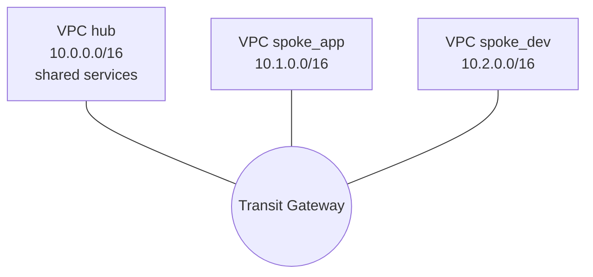

<div align="center">

**UNIVERSIDAD CENTRAL DEL ECUADOR**
**FACULTY OF ENGINEERING AND APPLIED SCIENCES**
**INFORMATION SYSTEMS**
**DISTRIBUTED PROGRAMMING**

## Hub-and-Spoke Architecture

**PROFESSOR:**
ING. JUAN PABLO GUEVARA

**NAME:**
CHILUISA ALEXIS

**ACADEMIC PERIOD:**
2026 – 2027

**DATE:**
23/11/2027

</div>

---

# 06 - Hub-and-Spoke Architecture

> This topic is infrastructure only: Terraform plus verification scripts, no Java code.

## What is it?

A network architecture model that organizes connectivity around a central node, the **Hub**, and several peripheral networks, the **Spokes**.
Its purpose is to centralize connectivity, simplify the administration of communications and apply common security controls, avoiding independent connections between every pair of networks.

With 3 networks the saving is small, but connecting every network with every other one grows quickly (10 networks need 45 connections), while Hub-and-Spoke needs only 10.

## How does it work?

- The **Hub** is the central interconnection point (shared services, firewalls, links to on-premises networks).
- Each **Spoke** is an independent network or environment, such as development, production or analytics.
- On AWS it is built with **Amazon VPC** and **AWS Transit Gateway**, which interconnects VPCs and hybrid connections.
- Connectivity depends on the **route tables** and policies. Using a Hub does **not** mean that every network can talk to every other one.

## Where can it be used?

Organizations with several VPCs, separate development and production environments, multi-account architectures and hybrid networks.
University example: academic, administrative and research systems in separate VPCs, with a central network managing their connectivity.

## Implementation in this project

Three VPCs connected through one Transit Gateway:



| File                            | Content                                                                                                                         |
| ------------------------------- | ------------------------------------------------------------------------------------------------------------------------------- |
| `terraform/main.tf`             | Provider, variables (including `allow_spoke_to_spoke`), AMI lookup and outputs.                                                 |
| `terraform/network.tf`          | The three VPCs with one subnet, an Internet Gateway and a route table each; the route `10.0.0.0/8` towards the Transit Gateway. |
| `terraform/tgw.tf`              | The Transit Gateway, the three VPC attachments, the two Transit Gateway route tables and their associations and propagations.   |
| `terraform/instances.tf`        | One small test instance per VPC and its security group.                                                                         |
| `scripts/test_connectivity.ps1` | Pings every instance from every other instance through AWS Systems Manager and prints the result.                               |

How the isolation works:

- The Transit Gateway has **default association and propagation disabled**, and uses two route tables of its own:
  - `hub-rt` (used by the hub attachment) learns the routes of every spoke.
  - `spokes-rt` (used by the spoke attachments) learns **only the hub route**.
- Result by default: **the spokes reach the hub and the hub reaches the spokes, but the spokes cannot reach each other** (a spoke has no route to the other spoke).
- Setting `allow_spoke_to_spoke = true` makes the spokes propagate their routes into `spokes-rt` as well, and spoke-to-spoke traffic starts to work.

Design notes:

- The instances are in subnets with an Internet Gateway **only** so that the Systems Manager agent can reach AWS without paying for VPC endpoints. Their security groups allow no inbound traffic except `ping` from `10.0.0.0/8`; there is no SSH and no key pair.
- The traffic being tested (between VPCs) goes through the Transit Gateway, because the route `10.0.0.0/8` points to it and the destination is outside the local VPC.
- In a production design the spokes would have private subnets with no Internet Gateway.
- All the VPC routes are defined with separate `aws_route` resources. A route table with inline `route` blocks would remove the route to the Transit Gateway on the next `terraform apply` (see the note in the evidences).

### AWS Academy Learner Lab notes

- **No IAM roles can be created:** the instances use the pre-created `LabInstanceProfile`.
- **Regions:** only `us-east-1` and `us-west-2` are available; the default is `us-east-1`.
- **Temporary credentials:** they expire when the lab session ends. After restarting the lab, copy the new credentials to `%USERPROFILE%\.aws\credentials`.
- **Cost:** each Transit Gateway attachment is billed by the hour (3 attachments), plus the three instances. Run `terraform destroy` when you finish.
- **VPC quota:** AWS allows 5 VPCs per region; this project creates 3 (plus the default one).

## How to deploy and test

Prerequisites: Terraform and the AWS CLI with the Learner Lab credentials (`aws sts get-caller-identity` must work).
Run the commands from `06-hub-and-spoke/`.

```powershell
# 1. Deploy (isolation mode, the default)
cd terraform
terraform init
terraform apply
terraform output
cd ..
```

```powershell
# 2. Test connectivity. The script waits for the instances to register in Systems Manager (1 to 3 minutes)
powershell -ExecutionPolicy Bypass -File .\scripts\test_connectivity.ps1 | Out-File -Encoding utf8 evidences/connectivity_isolated.txt
Get-Content evidences/connectivity_isolated.txt
```

```powershell
# 3. Inspect the routes learned by the Transit Gateway route tables
$rt = terraform -chdir=terraform output -json tgw_route_tables | ConvertFrom-Json
aws ec2 search-transit-gateway-routes --transit-gateway-route-table-id $rt.hub --filters "Name=state,Values=active" --output table | Out-File -Encoding utf8 evidences/tgw_routes_hub.txt
aws ec2 search-transit-gateway-routes --transit-gateway-route-table-id $rt.spokes --filters "Name=state,Values=active" --output table | Out-File -Encoding utf8 evidences/tgw_routes_spokes_isolated.txt
```

```powershell
# 4. Allow spoke-to-spoke traffic, wait about 30 seconds and test again
terraform -chdir=terraform apply -var="allow_spoke_to_spoke=true"
powershell -ExecutionPolicy Bypass -File .\scripts\test_connectivity.ps1 | Out-File -Encoding utf8 evidences/connectivity_open.txt
aws ec2 search-transit-gateway-routes --transit-gateway-route-table-id $rt.spokes --filters "Name=state,Values=active" --output table | Out-File -Encoding utf8 evidences/tgw_routes_spokes_open.txt
```

```powershell
# 5. Destroy everything to stop the charges
terraform -chdir=terraform destroy -var="allow_spoke_to_spoke=true"
```

Expected result:

| From      | To        | Isolation mode (default) | `allow_spoke_to_spoke = true` |
| --------- | --------- | ------------------------ | ----------------------------- |
| spoke_app | hub       | reachable                | reachable                     |
| spoke_dev | hub       | reachable                | reachable                     |
| hub       | spoke_app | reachable                | reachable                     |
| hub       | spoke_dev | reachable                | reachable                     |
| spoke_app | spoke_dev | **blocked**              | reachable                     |
| spoke_dev | spoke_app | **blocked**              | reachable                     |

In isolation mode `spokes-rt` should list only the hub route (`10.0.0.0/16`); in open mode it should also list `10.1.0.0/16` and `10.2.0.0/16`.

## Evidences

Raw files are stored in the [evidences/](evidences/) folder. The deployment was done on 2026-11-22 in an AWS Academy Learner Lab, region `us-east-1`.

| File | Content |
|------|---------|
| `evidences/connectivity_isolated.txt` | Ping matrix in isolation mode (the default). |
| `evidences/connectivity_open.txt` | Ping matrix with `allow_spoke_to_spoke = true`. |
| `evidences/tgw_routes_hub.txt` | Routes of the hub Transit Gateway route table. |
| `evidences/tgw_routes_spokes_isolated.txt`, `evidences/tgw_routes_spokes_open.txt` | Routes of the spokes route table in each mode. |
| `evidences/*.png` | Screenshots of the AWS console (listed below). |

### Connectivity in isolation mode (`connectivity_isolated.txt`)

```text
== Waiting for the instances to register in Systems Manager
== Private IPs
hub        10.0.1.49
spoke_app  10.1.1.71
spoke_dev  10.2.1.166
== Connectivity (3 pings from each source to each destination)
hub        -> spoke_app  (10.1.1.71   ) 3/3 replies  REACHABLE
hub        -> spoke_dev  (10.2.1.166  ) 3/3 replies  REACHABLE
spoke_app  -> hub        (10.0.1.49   ) 3/3 replies  REACHABLE
spoke_app  -> spoke_dev  (10.2.1.166  ) 0/3 replies  BLOCKED
spoke_dev  -> hub        (10.0.1.49   ) 3/3 replies  REACHABLE
spoke_dev  -> spoke_app  (10.1.1.71   ) 0/3 replies  BLOCKED
== Summary
From      To        Replies Result
----      --        ------- ------
hub       spoke_app       3 REACHABLE
hub       spoke_dev       3 REACHABLE
spoke_app hub             3 REACHABLE
spoke_app spoke_dev       0 BLOCKED
spoke_dev hub             3 REACHABLE
spoke_dev spoke_app       0 BLOCKED
```

### Connectivity with spoke-to-spoke traffic allowed (`connectivity_open.txt`)

```text
== Waiting for the instances to register in Systems Manager
== Private IPs
hub        10.0.1.49
spoke_app  10.1.1.71
spoke_dev  10.2.1.166
== Connectivity (3 pings from each source to each destination)
hub        -> spoke_app  (10.1.1.71   ) 3/3 replies  REACHABLE
hub        -> spoke_dev  (10.2.1.166  ) 3/3 replies  REACHABLE
spoke_app  -> hub        (10.0.1.49   ) 3/3 replies  REACHABLE
spoke_app  -> spoke_dev  (10.2.1.166  ) 3/3 replies  REACHABLE
spoke_dev  -> hub        (10.0.1.49   ) 3/3 replies  REACHABLE
spoke_dev  -> spoke_app  (10.1.1.71   ) 3/3 replies  REACHABLE
== Summary
From      To        Replies Result
----      --        ------- ------
hub       spoke_app       3 REACHABLE
hub       spoke_dev       3 REACHABLE
spoke_app hub             3 REACHABLE
spoke_app spoke_dev       3 REACHABLE
spoke_dev hub             3 REACHABLE
spoke_dev spoke_app       3 REACHABLE
```

### Transit Gateway routes

Summary of `tgw_routes_hub.txt`, `tgw_routes_spokes_isolated.txt` and `tgw_routes_spokes_open.txt`. The VPC behind each attachment is identified by its VPC id.

```text
hub-rt (same in both modes)
  10.1.0.0/16   propagated  from spoke_app (tgw-attach-0a9e129e8acae8347)
  10.2.0.0/16   propagated  from spoke_dev (tgw-attach-051077eef91becd4c)

spokes-rt, isolation mode
  10.0.0.0/16   propagated  from hub       (tgw-attach-028b3f085d5122061)

spokes-rt, allow_spoke_to_spoke = true
  10.0.0.0/16   propagated  from hub       (tgw-attach-028b3f085d5122061)
  10.1.0.0/16   propagated  from spoke_app (tgw-attach-0a9e129e8acae8347)
  10.2.0.0/16   propagated  from spoke_dev (tgw-attach-051077eef91becd4c)
```

### What the evidence shows

| From | To | Isolation mode | `allow_spoke_to_spoke = true` |
|------|----|----------------|-------------------------------|
| hub | spoke_app | reachable (3/3) | reachable (3/3) |
| hub | spoke_dev | reachable (3/3) | reachable (3/3) |
| spoke_app | hub | reachable (3/3) | reachable (3/3) |
| spoke_dev | hub | reachable (3/3) | reachable (3/3) |
| spoke_app | spoke_dev | **blocked (0/3)** | reachable (3/3) |
| spoke_dev | spoke_app | **blocked (0/3)** | reachable (3/3) |

- **The routes explain the result:** `hub-rt` knows both spokes and `spokes-rt` knows the hub, so the hub talks to both spokes and the spokes talk to the hub. In isolation mode `spokes-rt` has no route to `10.1.0.0/16` or `10.2.0.0/16`, so a packet from one spoke to the other has nowhere to go and is dropped.
- **One variable changes the behavior:** setting `allow_spoke_to_spoke = true` only adds two route propagations. `spokes-rt` went from 1 to 3 routes and the two blocked paths started to answer, without touching the VPCs or the instances.
- **Having a Hub does not mean full connectivity:** all the VPCs are attached to the same Transit Gateway, yet two of them could not reach each other until the route tables allowed it.
- **Security groups were not the limit:** every instance accepts ping from `10.0.0.0/8` in both modes; what changed the result was the routing.

Note on the Terraform code: in a first deployment, the route `10.0.0.0/8` towards the Transit Gateway disappeared from the VPC route tables after the second `terraform apply`. The cause is that a route table with inline `route` blocks removes the routes created by separate `aws_route` resources on the next apply.
The configuration was fixed to define every route with `aws_route`, and the evidences above come from the corrected deployment (the route can be seen in screenshot 7).

### Screenshots

Screenshots 1 to 4 and 8 were taken in an earlier deployment of the same configuration, so the resource ids shown in them differ from the ones in the text files; the structure is the same.

**1. AWS console: the three VPCs created by Terraform (`hub` 10.0.0.0/16, `spoke_app` 10.1.0.0/16 and `spoke_dev` 10.2.0.0/16) next to the default VPC of the account.**


**2. AWS console: the Transit Gateway `hub-tgw` in *Available* state.**


**3. AWS console: the three attachments of the Transit Gateway (`hub-attachment`, `spoke_app-attachment` and `spoke_dev-attachment`), all of type VPC and *Available*.**


**4. AWS console: Transit Gateway route table `hub-rt`, with the propagated routes of both spokes (10.1.0.0/16 and 10.2.0.0/16).**


**5. AWS console: Transit Gateway route table `spokes-rt` in isolation mode. It has **one** route, the hub (10.0.0.0/16): the spokes have no route to each other.**


**6. AWS console: `spokes-rt` after `allow_spoke_to_spoke = true`. It now has **three** routes (hub, `spoke_app` and `spoke_dev`).**


**7. AWS console: route table `hub-rt` of the hub VPC, with the route to the Internet Gateway, the local route (10.0.0.0/16) and `10.0.0.0/8` towards the Transit Gateway.**


**8. AWS console: the three test instances (`hub-test`, `spoke_app-test` and `spoke_dev-test`) running, with their status checks passed.**


> Once the evidences are collected, destroy the AWS resources with `terraform destroy -var="allow_spoke_to_spoke=true"` to stop the charges.
