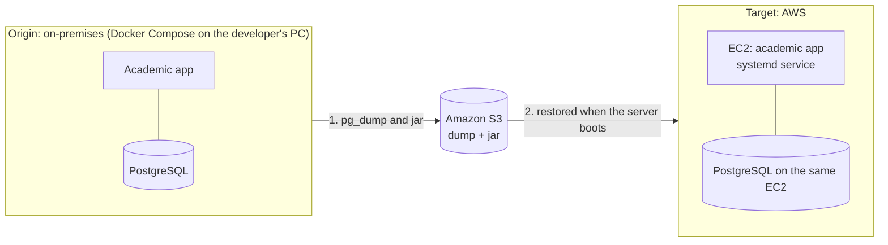
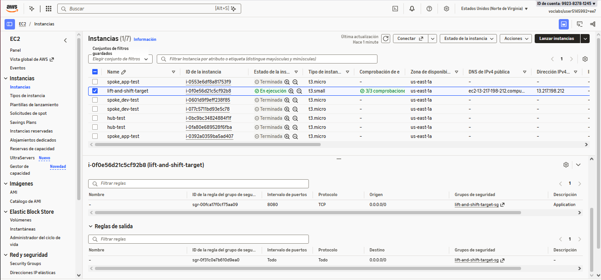

[Leer en español](README.es.md)

<div align="center">

**UNIVERSIDAD CENTRAL DEL ECUADOR**
**FACULTY OF ENGINEERING AND APPLIED SCIENCES**
**INFORMATION SYSTEMS**
**DISTRIBUTED PROGRAMMING**

## Lift-and-Shift Migration Strategy

**PROFESSOR:**
ING. JUAN PABLO GUEVARA

**NAME:**
CHILUISA ALEXIS

**ACADEMIC PERIOD:**
2026 – 2027

**DATE:**
23/11/2027

</div>

---

# 07 - Lift-and-Shift (Rehost) migration to AWS (Java)

## What is it?

A migration strategy, also called **Rehost**, that moves applications or servers from an on-premises infrastructure to the cloud **with minimal changes** to their architecture and behavior.
Its goal is to speed up the adoption of the cloud and to avoid a full redesign of the systems during the first migration.

It does **not** guarantee lower costs or better scalability by itself: it keeps the limitations of the original infrastructure.
Modernization (containers, managed databases, serverless) comes later.

## How does it work?

1. **Discovery** of the on-premises servers and analysis of their dependencies.
2. **Preparation** of the target environment.
3. **Replication** of the data and the servers.
4. **Testing** before the final switch.
5. **Cutover**: the traffic moves to the new environment.

On AWS, **Amazon EC2** hosts the migrated servers and **AWS Application Migration Service (MGN)** replicates them continuously (an agent on the source server sends block-level data to AWS, then test and cutover instances are launched).

## Where can it be used?

Legacy systems, enterprise applications that need a fast migration, and organizations that want to leave physical infrastructure without a deep modernization at first.
University example: an administrative system running on a local server is moved to Amazon EC2, keeping its technology stack for the time being.

## Implementation in this project

A small "legacy" academic system (Spring Boot + PostgreSQL) is migrated from a simulated on-premises environment to an EC2 server. The stack is **not** changed: Java and PostgreSQL stay on the same server, as they were. That is what makes it a lift-and-shift and not a modernization.



| Path | Content |
|------|---------|
| `app/` | The application: `GET /health`, `GET /info`, `GET /students`, `POST /students`, and its `Dockerfile` (used by the origin). |
| `db/init.sql` | Schema and sample data of the origin database. |
| `docker-compose.yml` | The simulated on-premises environment: the application and PostgreSQL. |
| `migration/cutover.ps1` | The cutover: freezes the origin, exports the database, uploads the files, creates the target and measures the interruption time. |
| `terraform/main.tf` | The name of the S3 bucket and, once `migrate = true`, the target server (EC2 and security group). |
| `terraform/user_data.sh.tftpl` | What the target server does when it boots: installs Java and PostgreSQL, restores the dump and starts the application. |
| `SmokeTest.java` | Functional check run against the origin and against the target. |

What changes and what does not:

| | Origin | Target |
|---|--------|--------|
| Application | `academic-app.jar` | **the same jar** |
| Database engine | PostgreSQL 16 | PostgreSQL 16 (installed on the same server, not RDS) |
| Data | Students table | restored from the dump, **same rows** |
| Configuration | `DATABASE_URL=jdbc:postgresql://db:5432/academic` | `DATABASE_URL=jdbc:postgresql://localhost:5432/academic` (only the host changes) |
| Where it runs | Docker Compose, developer's PC | EC2 `t3.small`, Amazon Linux 2023 |

### AWS Application Migration Service (MGN): documented, not executed

MGN needs an agent installed on the source server and several roles and permissions that AWS Academy Learner Lab usually restricts, so this project performs the migration manually (export, upload and restore).
With MGN the process would be:

1. Initialize MGN in the target region and create a replication settings template.
2. Install the AWS Replication Agent on the source server; it starts replicating the disks continuously.
3. When the initial sync reaches *Ready for testing*, launch a **test instance** and run `SmokeTest.java` against it.
4. Mark the server as *Ready for cutover*, launch the **cutover instance**, switch the traffic and finalize the migration.

The main difference with this project is the interruption time: MGN keeps the data replicated while the source runs, so the downtime is only the final switch. The manual procedure freezes the origin before exporting, so the downtime includes the export, the upload and the boot of the target.

### AWS Academy Learner Lab notes

- **No IAM roles can be created:** the instance uses the pre-created `LabInstanceProfile`, which lets it read from S3.
- **Regions:** only `us-east-1` and `us-west-2` are available; the default is `us-east-1`.
- **Temporary credentials:** they expire when the lab session ends. After restarting the lab, copy the new credentials to `%USERPROFILE%\.aws\credentials`.
- **S3 buckets are created with the AWS CLI:** the Learner Lab service control policy denies `s3:GetBucketObjectLockConfiguration`, which the Terraform AWS provider calls when it manages a bucket. Terraform only uses the bucket name.
- **Cost:** the `t3.small` instance is billed while it exists. Run `terraform destroy` when you finish.

## How to run

Prerequisites: Docker Desktop running, Maven, Terraform and the AWS CLI with the Learner Lab credentials (`aws sts get-caller-identity` must work).
Run the commands from `07-lift-and-shift/`.

```powershell
# 1. Origin: start the "on-premises" system and check it (BEFORE the migration)
docker compose up --build -d
Start-Sleep -Seconds 20
java SmokeTest.java http://localhost:8080 | Out-File -Encoding utf8 evidences/before.txt
Get-Content evidences/before.txt
```

```powershell
# 2. Build the jar that will be migrated
mvn -f app/pom.xml package -DskipTests

# 3. Create the S3 bucket with the AWS CLI (the target server is not created yet)
terraform -chdir=terraform init
terraform -chdir=terraform apply -auto-approve
$bucket = terraform -chdir=terraform output -raw bucket_name
aws s3 mb "s3://$bucket"
```

```powershell
# 4. Cutover: freeze the origin, export, upload, create the target and wait until it answers (about 5 to 10 minutes).
#    The steps and the interruption time are saved in evidences/cutover.txt
powershell -ExecutionPolicy Bypass -File .\migration\cutover.ps1
```

```powershell
# 5. Check the target (AFTER the migration) and save the Terraform outputs
$url = terraform -chdir=terraform output -raw app_url
java SmokeTest.java $url | Out-File -Encoding utf8 evidences/after.txt
Get-Content evidences/after.txt
terraform -chdir=terraform output | Out-File -Encoding utf8 evidences/terraform_outputs.txt
```

> Windows PowerShell writes `>` redirections as UTF-16. That is why the commands use `Out-File -Encoding utf8`.

```powershell
# 6. Destroy everything to stop the charges
terraform -chdir=terraform destroy -var="migrate=true" -auto-approve
aws s3 rb "s3://$bucket" --force
docker compose down -v
```

Expected: `before.txt` and `after.txt` show the same students (and `after.txt` also contains the row created by the test run before the migration, proving that the data travelled), `/info` shows a different `host` and a different `database` host,
and `cutover.txt` ends with the service interruption time.

## Evidences

Raw files are stored in the [evidences/](evidences/) folder.

| File | How to generate |
|------|-----------------|
| `evidences/before.txt` | Step 1: functional check of the origin. |
| `evidences/cutover.txt` | Step 4: the steps of the cutover with their times and the interruption time. |
| `evidences/after.txt` | Step 5: functional check of the target. |
| `evidences/terraform_outputs.txt` | Step 5: bucket, target URL and addresses. |
| Screenshots | AWS console: the S3 bucket with the two uploaded files, and the EC2 instance running. |

Generated on 2026-11-22 in an AWS Academy Learner Lab, region `us-east-1`. The full files are in [evidences/](evidences/).

### Before the migration (`before.txt`)

Check of the origin. The last line creates a test row (id 4) before the origin is frozen.

```text
target: http://localhost:8080
GET  /info -> HTTP 200 | {"host":"e964318f3d41","database":"jdbc:postgresql://db:5432/academic","java":"17.0.21.1","students":3}
GET  /health -> HTTP 200 | {"status":"ok"}
GET  /students -> HTTP 200 | [{"id":1,"name":"Ana Torres"},{"id":2,"name":"Luis Mena"},{"id":3,"name":"Marta Quispe"}]
POST /students -> HTTP 201 | {"name":"Smoke test 2026-11-22T23:23:56","id":4}
```

### Cutover (`cutover.txt`)

```text
Cutover started 2026-11-22 23:36:13
[23:36:13] 1/5 Freezing the origin: the application is stopped, no more writes
[23:36:17] 2/5 Exporting the database from the origin
[23:36:20] 3/5 Uploading the dump and the jar to S3 (lift-and-shift-992382781245-us-east-1)
[23:36:28] 4/5 Creating the target server (it installs the stack and restores the data when it boots)
[23:37:56] 5/5 Waiting for the migrated application to answer at http://13.217.198.212:8080
[23:38:48] Target answering at http://13.217.198.212:8080
Service interruption (origin stopped -> target answering): 155 s (02:35)
```

### After the migration (`after.txt`)

Check of the target, at the new address.

```text
target: http://13.217.198.212:8080
GET  /info -> HTTP 200 | {"host":"ip-172-31-16-70.ec2.internal","database":"jdbc:postgresql://localhost:5432/academic","java":"17.0.21.1","students":4}
GET  /health -> HTTP 200 | {"status":"ok"}
GET  /students -> HTTP 200 | [{"id":1,"name":"Ana Torres"},{"id":2,"name":"Luis Mena"},{"id":3,"name":"Marta Quispe"},{"id":4,"name":"Smoke test 2026-11-22T23:23:56"}]
POST /students -> HTTP 201 | {"id":5,"name":"Smoke test 2026-11-22T23:39:34"}
```

### Terraform outputs (`terraform_outputs.txt`)

```text
app_url = "http://13.217.198.212:8080"
bucket_name = "lift-and-shift-992382781245-us-east-1"
target_instance_id = "i-0f0e56d21c5cf92b8"
target_private_ip = "172.31.16.70"
```

### Screenshots

**1. Origin, before the migration: the application running on the developer's computer (`localhost:8080/students`) with its 3 students.**


**2. AWS console: the S3 bucket with the two files uploaded by the cutover, `academic-app.jar` (21.8 MB) and `academic.sql` (2.3 KB).**


**3. AWS console: the target server `lift-and-shift-target` (`t3.small`) running, with its public IP 13.217.198.212 and private IP 172.31.16.70.**


**4. AWS console: security group of the target. The only inbound rule is TCP 8080 (the application); there is no SSH.**



**5. After the migration: the same application answering from AWS (`13.217.198.212:8080/students`), with the 3 original students, the row created before the migration (id 4) and the one created by the check on the target (id 5).**


### Before and after comparison

| Aspect | Before (origin) | After (target) |
|--------|-----------------|----------------|
| Address | `http://localhost:8080` | `http://13.217.198.212:8080` |
| Host reported by `/info` | `e964318f3d41` (container) | `ip-172-31-16-70.ec2.internal` (EC2, private IP 172.31.16.70) |
| Application | `academic-app.jar`, Java 17.0.21.1 | **the same jar**, Java 17.0.21.1 |
| Application configuration | `DATABASE_URL=jdbc:postgresql://db:5432/academic` | `DATABASE_URL=jdbc:postgresql://localhost:5432/academic` (only the host changed) |
| Rows | 3 original + 1 test row = 4 when the origin was frozen | 4 on arrival (ids 1 to 4, same names); the next insert received id 5 |
| Service interruption | | **155 s (2 min 35 s)** |

### What the evidence shows

- **Nothing in the application changed:** the jar and the Java version are the same. The only configuration difference is the host in `DATABASE_URL` (`db` in the Docker network, `localhost` on the server). This is what makes it a lift-and-shift: the system was moved, not redesigned.
- **The data travelled:** the target has the same rows with the same ids and names, including the test row created before the migration (id 4). The next insert received id **5** and not 1, so the sequence of the table was migrated as well.
- **The environment is different:** `/info` reports another host, another address and a database reached through `localhost`, which shows that the answers come from the new server and not from the origin (which was stopped).
- **Where the 155 seconds of interruption went**, from the times of the cutover:

| Step | Time |
|------|------|
| Freezing the origin (stopping the application) | 4 s |
| Exporting the database with `pg_dump` | 3 s |
| Uploading the dump and the jar to S3 | 8 s |
| Creating the target server (`terraform apply`) | 88 s |
| Booting the server, installing Java and PostgreSQL, restoring the data and starting the application | 52 s |
| **Total** | **155 s** |

- **The interruption is dominated by creating and booting the target (140 of the 155 seconds)**, not by moving the data (11 s with this sample database). With a larger database the export and upload would grow. AWS Application Migration Service avoids this by replicating the data continuously while the origin keeps running, so the downtime is only the final switch.
- **Limits of the result:** the system is simply running in another place. It is still one server hosting the application and the database, without high availability or scaling, which is the starting point for a later modernization. The security group exposes port 8080 to the Internet over plain HTTP, which is acceptable only for this example.

> Once the evidences are collected, destroy the AWS resources with `terraform destroy -var="migrate=true"` and delete the bucket with `aws s3 rb` to stop the charges (see step 6).
