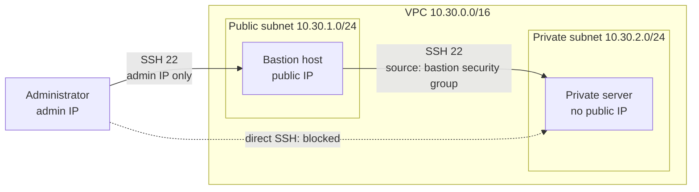
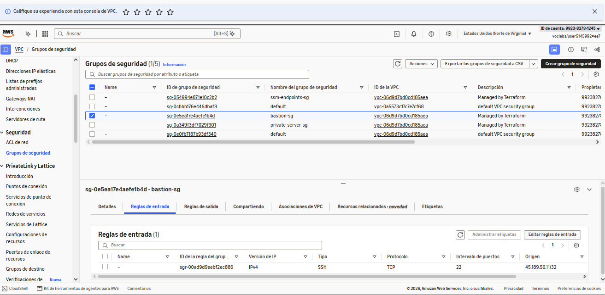
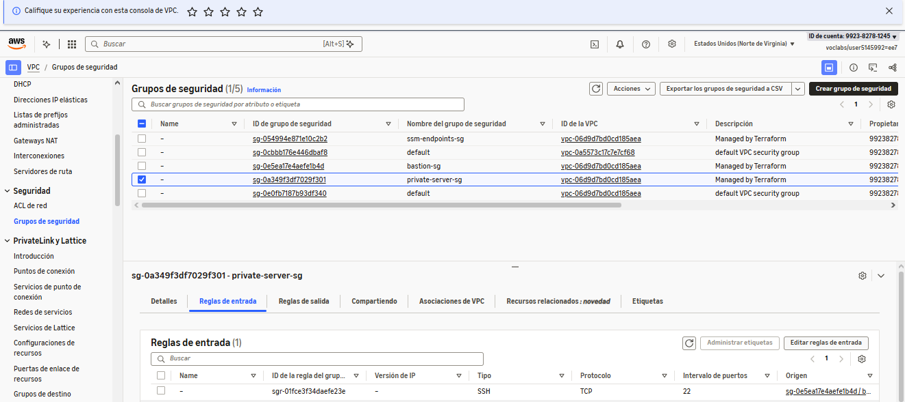
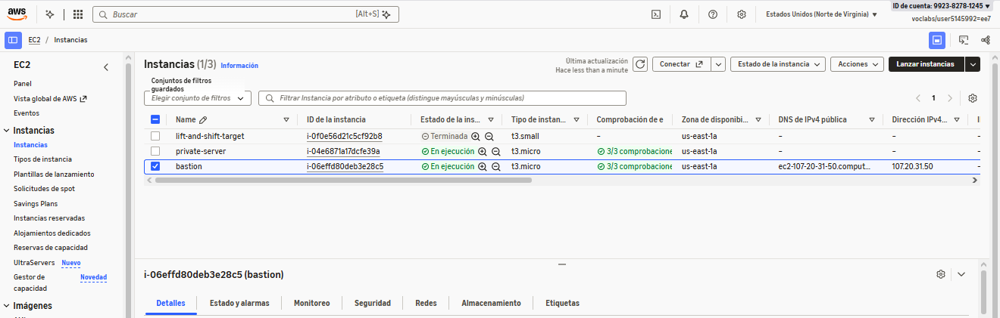
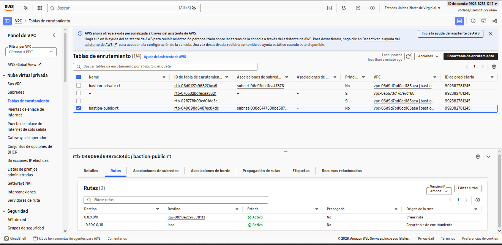
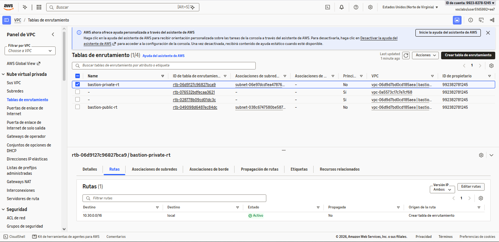
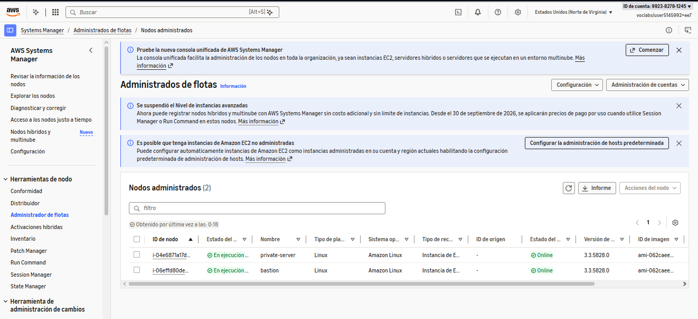

<div align="center">

**UNIVERSIDAD CENTRAL DEL ECUADOR**
**FACULTY OF ENGINEERING AND APPLIED SCIENCES**
**INFORMATION SYSTEMS**
**DISTRIBUTED PROGRAMMING**

## Bastion Host

**PROFESSOR:**
ING. JUAN PABLO GUEVARA

**NAME:**
CHILUISA ALEXIS

**ACADEMIC PERIOD:**
2026 – 2027

**DATE:**
23/11/2027

</div>

---

# 08 - Bastion Host

> This topic is infrastructure only: Terraform plus a verification script, no Java code.

## What is it?

A hardened server that acts as the **controlled administrative entry point** to resources located in private networks.
Its purpose is to reduce the direct exposure of the internal servers, centralize the administrative access and make it easier to apply security controls and auditing.

## How does it work?

In the traditional architecture the bastion lives in a **public subnet**. Administrators connect to it with SSH (or another authorized protocol) and, from there, reach the instances located in **private subnets**, which have no public address.

Access must be restricted with security groups, strong authentication (keys, not passwords), key management and audit logs.



On AWS there is also an alternative that avoids keeping a bastion: **AWS Systems Manager Session Manager**, which manages compatible instances without opening port 22 to the Internet.

## Where can it be used?

Enterprise networks, hybrid infrastructures, systems with private servers and environments that require restricted administrative access.
University example: the infrastructure team administers internal servers without exposing them directly to the Internet.

## Implementation in this project

`terraform/` creates a VPC with a public subnet for the bastion and a private subnet for an application server.

| File                      | Content                                                                                                                         |
| ------------------------- | ------------------------------------------------------------------------------------------------------------------------------- |
| `terraform/main.tf`       | Provider, variables (`admin_cidr`, `key_name`, `enable_ssm`), AMI lookup and outputs.                                           |
| `terraform/network.tf`    | The VPC, Internet Gateway, public and private subnets and their route tables. The private route table has only the local route. |
| `terraform/instances.tf`  | The two security groups, the bastion, the private server and, optionally, the Systems Manager endpoints.                        |
| `scripts/test_access.ps1` | Checks which paths to the private server work and which are blocked.                                                            |

How access is restricted:

| Resource                      | Rule                                                                                                         |
| ----------------------------- | ------------------------------------------------------------------------------------------------------------ |
| Bastion security group        | SSH (22) only from `admin_cidr`, the administrator's public IP.                                              |
| Private server security group | SSH (22) **only from the bastion security group**.                                                           |
| Private server                | No public IP, in a subnet whose route table has no route to the Internet.                                    |
| Authentication                | Key pair only (`vockey` in Learner Lab). Amazon Linux does not allow password logins by default.             |
| Audit                         | `sshd` records every login on the bastion, which is the single point where all administrative sessions pass. |

### Optional: Systems Manager instead of SSH

With `enable_ssm = true`, three VPC interface endpoints (`ssm`, `ssmmessages`, `ec2messages`) are created in the private subnet, so the private server can register in Systems Manager **without any route to the Internet and without port 22**.
The script then runs a command on the private server through Systems Manager, to compare both mechanisms.

|                          | Bastion host               | Systems Manager                      |
| ------------------------ | -------------------------- | ------------------------------------ |
| Open port                | 22 on the bastion          | none                                 |
| Extra server to maintain | yes (the bastion)          | no                                   |
| Credentials              | SSH key pair               | IAM permissions                      |
| Audit                    | `sshd` logs on the bastion | AWS-side session and command history |
| Extra cost               | one instance               | the three interface endpoints        |

### AWS Academy Learner Lab notes

- **Key pair:** Learner Lab provides an existing key pair called `vockey`. Its private key is the file `labsuser.pem`, downloaded from **AWS Details**.
- **No IAM roles can be created:** both instances use the pre-created `LabInstanceProfile`.
- **Regions:** only `us-east-1` and `us-west-2` are available; the default is `us-east-1`.
- **Temporary credentials:** they expire when the lab session ends (about 4 hours). After restarting the lab, copy the new credentials to `%USERPROFILE%\.aws\credentials`.
- **Cost:** two `t3.micro` instances, plus the three endpoints if `enable_ssm = true`. Run `terraform destroy` when you finish.

## How to deploy and test

Prerequisites: Terraform, the AWS CLI with the Learner Lab credentials (`aws sts get-caller-identity` must work) and the OpenSSH client (`ssh -V`, included in Windows 10 and 11).
Run the commands from `08-bastion/`.

```powershell
# 1. Key pair: in AWS Academy open "AWS Details" and press "Download PEM" (labsuser.pem).
#    Save it as %USERPROFILE%\.ssh\labsuser.pem and restrict its permissions (ssh refuses keys readable by others)
New-Item -ItemType Directory -Force "$env:USERPROFILE\.ssh" | Out-Null
$key = "$env:USERPROFILE\.ssh\labsuser.pem"
icacls $key /inheritance:r
icacls $key /grant:r "${env:USERNAME}:R"
```

```powershell
# 2. Your public IP: the only address allowed to reach the bastion
$myip = (Invoke-RestMethod https://checkip.amazonaws.com).Trim() + "/32"
$myip
```

```powershell
# 3. Deploy
terraform -chdir=terraform init
terraform -chdir=terraform apply -auto-approve -var="admin_cidr=$myip"
terraform -chdir=terraform output
```

Wait 1 to 2 minutes for the two instances to finish booting (_2/2 checks passed_ in the EC2 console).

```powershell
# 4. Test the access paths
powershell -ExecutionPolicy Bypass -File .\scripts\test_access.ps1 -KeyFile $key | Out-File -Encoding utf8 evidences/access_tests.txt
Get-Content evidences/access_tests.txt
```

```powershell
# 5. Optional: add Systems Manager and compare. Wait about 3 minutes after the apply
terraform -chdir=terraform apply -auto-approve -var="admin_cidr=$myip" -var="enable_ssm=true"
powershell -ExecutionPolicy Bypass -File .\scripts\test_access.ps1 -KeyFile $key -Ssm | Out-File -Encoding utf8 evidences/access_tests_ssm.txt
Get-Content evidences/access_tests_ssm.txt
```

```powershell
# 6. Destroy everything to stop the charges
terraform -chdir=terraform destroy -auto-approve -var="admin_cidr=$myip" -var="enable_ssm=true"
```

To connect by hand through the bastion, an ssh configuration file is needed because `-i` does not apply to the jump host. Example `%USERPROFILE%\.ssh\config` (replace the two addresses with the Terraform outputs):

```text
Host bastion
  HostName <bastion_public_ip>
  User ec2-user
  IdentityFile ~/.ssh/labsuser.pem

Host private
  HostName <private_server_ip>
  User ec2-user
  IdentityFile ~/.ssh/labsuser.pem
  ProxyJump bastion
```

Then `ssh bastion` opens the bastion and `ssh private` reaches the private server through it.

> If your public IP changes (for example when you change networks), the bastion stops answering. Run step 3 again with the new `$myip`.

Expected result:

| Test                                             | Expected                                                           |
| ------------------------------------------------ | ------------------------------------------------------------------ |
| 1. SSH straight to the private server            | **blocked** (no public IP, no route, security group)               |
| 2. SSH to the bastion from the administrator IP  | works                                                              |
| 3. SSH to the private server through the bastion | works, and shows the hostname and private IP of the private server |
| 4. Audit on the bastion                          | the number of logins recorded by `sshd`                            |
| 5. Systems Manager (optional)                    | works without SSH and without the bastion                          |

## Evidences

Raw files are stored in the [evidences/](evidences/) folder.

| File                             | How to generate                                                                                                                                                                                                                                         |
| -------------------------------- | ------------------------------------------------------------------------------------------------------------------------------------------------------------------------------------------------------------------------------------------------------- |
| `evidences/access_tests.txt`     | Step 4: results of the access tests.                                                                                                                                                                                                                    |
| `evidences/access_tests_ssm.txt` | Step 5 (optional): the same tests plus Systems Manager.                                                                                                                                                                                                 |
| Screenshots                      | AWS console: the two security groups with their inbound rules, the two instances (the private one without public IPv4), the route tables of the public and the private subnets, and (optional) the private server as a managed node in Systems Manager. |

Results of the real deployment in AWS Academy Learner Lab (`us-east-1`). The Terraform apply, the access tests and the screenshots were taken from the same deployment. The bastion public address was `107.20.31.50` and the private server `10.30.2.173`.

### Access tests

From `evidences/access_tests.txt`:

```text
== TEST 1: SSH straight to the private server (no bastion)
BLOCKED (expected): ssh: connect to host 10.30.2.173 port 22: Connection timed out

== TEST 2: SSH to the bastion from the administrator IP
OK
ip-10-30-1-5.ec2.internal
10.30.1.5

== TEST 3: SSH to the private server through the bastion
OK
ip-10-30-2-173.ec2.internal
10.30.2.173

== TEST 4: audit trail kept by the bastion (successful SSH logins recorded by sshd)
OK: 3 successful logins recorded on the bastion
```

| Test | Result | Meaning |
|------|--------|---------|
| 1. Direct SSH to the private server | **blocked** (timeout) | The private address `10.30.2.173` is not routable from the Internet. The connection never reaches the server. |
| 2. SSH to the bastion | works | The bastion security group accepts port 22 from the administrator IP. |
| 3. SSH to the private server through the bastion | works | The private server answers only to the bastion security group. The session shows the server's own hostname and private IP. |
| 4. Audit | 3 logins | `sshd` on the bastion recorded the logins of this run (tests 2 and 4 directly, test 3 as the jump). Every administrative session leaves a trace in one place. |

### Systems Manager (optional)

The same tests with `enable_ssm=true`, from `evidences/access_tests_ssm.txt`:

```text
== TEST 4: audit trail kept by the bastion (successful SSH logins recorded by sshd)
OK: 6 successful logins recorded on the bastion

== TEST 5: manage the private server with Systems Manager (no SSH, no bastion)
OK (status Success)
ip-10-30-2-173.ec2.internal
10.30.2.173
```

Tests 1 to 3 gave the same results as before. Test 5 ran `hostname` on the private server through Systems Manager, **without port 22 and without passing through the bastion**: the command reached the private server through the three VPC endpoints.
The audit counter went from 3 to 6 because the sshd log is cumulative: the second run added its own 3 logins. Systems Manager commands do not appear in that log, because they never go through the bastion; they are recorded on the AWS side.

### Screenshots

**Bastion security group.** One inbound rule: SSH (22) only from the administrator public IP (`/32`).



**Private server security group.** One inbound rule: SSH (22) whose source is the bastion security group (`sg-0e5ea17e4aefe1b4d`), not an IP range.



**Instances.** The bastion has a public IPv4 (`107.20.31.50`); `private-server` has none (empty public DNS and IPv4 columns). Both passed 3/3 checks. The terminated `lift-and-shift-target` is left over from topic 07.



**Public route table (`bastion-public-rt`).** Besides the local route it has `0.0.0.0/0` towards the Internet Gateway.



**Private route table (`bastion-private-rt`).** Only the local route `10.30.0.0/16`: there is no way out to the Internet.



**Systems Manager Fleet Manager (optional).** Both instances appear as managed nodes (*Online*), including `private-server`, which has no Internet route: it registered through the VPC endpoints.



### Comparison of the access mechanisms

| | Bastion host | Systems Manager |
|---|--------------|-----------------|
| Reached the private server | yes, with SSH `ProxyJump` | yes, with `send-command` |
| Required inbound port | 22 on the bastion, limited to one IP | none |
| Direct access to the private server | blocked (test 1) | not needed |
| Where the access is recorded | `sshd` log on the bastion (3 and then 6 logins) | AWS-side command history |
| Extra resources | one instance with a public IP | three interface endpoints |

Conclusions:

- The three layers work together: no public IP, a route table without Internet route, and a security group that only trusts the bastion. Removing any one of them would leave the server less protected.
- The bastion centralizes the administrative access, but it is itself an exposed server: it must be patched, and its rule must stay limited to known addresses. In this run it only accepted the administrator `/32`.
- Systems Manager removes the exposed port and the extra server, at the cost of the interface endpoints, and moves the audit to AWS.
